<header class="wk-hero">
  

    

      

        <h1 class="wk-hero__title">從前沿研究， 到產線與真實產品。</h1>
        
專注於電腦視覺、異常檢測與生成式模型研究與實作。涵蓋從演算法創新、國際會議論文與專利，到 4K+ 解析度免訓練瑕疵檢測、獨立產品與硬體原型的完整作品。

        

          <a href="#ai-research" class="wk-btn wk-btn--ink">DuoAD · arXiv ’26</a>
          <a href="#lssgen-section" class="wk-btn wk-btn--ghost">LSSGen · ICCVW ’25</a>
          <a href="/about/" class="wk-link-inline">完整經歷與履歷 →</a>
        

      

      <dl class="wk-proof-strip" aria-label="核心研究與技術亮點">
        

          <dt>第一作者論文</dt>
          <dd><strong>2 篇</strong>DuoAD · LSSGen (ICCVW ’25)</dd>
        

        

          <dt>申請中專利家族</dt>
          <dd><strong>6 項</strong>涵蓋台 / 中 / 美擴散合成與瑕疵檢測</dd>
        

        

          <dt>工業視覺落地</dt>
          <dd><strong>4K+ 解析度</strong>免訓練、極少樣本瑕疵檢測方案</dd>
        

        

          <dt>擴散模型加速</dt>
          <dd><strong>1.5×</strong>FLUX.1-dev · 54s → 36s</dd>
        

      </dl>
    

  

</header>

<nav class="wk-subnav" aria-label="作品分類導覽">
  

    

      <a href="#ai-research" class="is-active">AI Research</a>
      <a href="#applied-ai">Applied AI</a>
      <a href="#personal-products">Personal Products</a>
      <a href="#visual-interactive">Visual &amp; Interactive</a>
      <a href="#hardware-prototyping">Hardware</a>
    

    <a href="/about/" class="wk-subnav__resume">About &amp; Resume →</a>
  

</nav>

<!-- ========================================================================
     FLAGSHIP 01: DUOAD (FULL-BLEED OBSIDIAN-BRONZE STAGE)
     ======================================================================== -->
<section class="wk-band wk-band--duoad" id="ai-research" aria-labelledby="duoad">
  

    

      

        

          <h2 id="duoad" class="wk-flagship__name">DuoAD</h2>
          

            arXiv 2026 · First Author
            Production Deployed
          

        

        
Leveraging ViT <code>[CLS]</code> Dual Characteristics for Training-Free Few-Shot Anomaly Detection

        
發現並運用 ViT <code>[CLS]</code> token 的雙重特性：以穩定的全域語意自動校準資料增強，再以對局部異常高度敏感的 attention logits 強化瑕疵定位。只需極少正常樣本、完全免訓練、免逐類調參，即達 Few-Shot Anomaly Detection SOTA，並作為產線異常檢測方案的核心演算法之一投入部署。

      

      

        

          <a href="https://imrton.github.io/%E8%AB%96%E6%96%87/DuoAD/" class="wk-btn wk-btn--amber">Project Page</a>
          <a href="https://arxiv.org/abs/2607.23924" class="wk-btn wk-btn--dark-outline">arXiv</a>
          <a href="https://github.com/inventec-ai-center/DuoAD" class="wk-btn wk-btn--dark-outline">GitHub</a>
        

        <ul class="wk-skill-row wk-skill-row--dark" aria-label="DuoAD 核心技術">
          <li>PyTorch</li>
          <li>Vision Transformer</li>
          <li>Few-Shot AD</li>
          <li>Training-Free</li>
          <li>Edge Deployment</li>
        </ul>
      

    

    

      

        

          
          <h3>Research SOTA · MVTec-AD Benchmark</h3>
        

        

          

            <strong class="wk-metric__val wk-metric__val--amber">97.7%</strong>
            MVTec-AD image AUROC
          

          

            <strong class="wk-metric__val wk-metric__val--amber">1 / 4-shot</strong>
            極少正常樣本啟動檢測
          

          

            <strong class="wk-metric__val wk-metric__val--amber">0 training</strong>
            免訓練、免逐類別手動調參
          

        

      

      

        

          
          <h3>Deployment Capabilities · 4K+ 解析度免訓練瑕疵檢測</h3>
        

        

          

            <strong class="wk-metric__val wk-metric__val--emerald">4K+</strong>
            原生支援超高解析度影像檢測
          

          

            <strong class="wk-metric__val wk-metric__val--emerald">Edge Ready</strong>
            低顯存預算之邊緣工作站部署
          

          

            <strong class="wk-metric__val wk-metric__val--emerald">Core Algo</strong>
            產線免訓練檢測核心演算法之一
          

        

      

    

    

      <figure class="wk-plate">
        <a href="/assets/imgs/Papers/DuoAD/teaser.jpg" class="wk-plate__frame">
          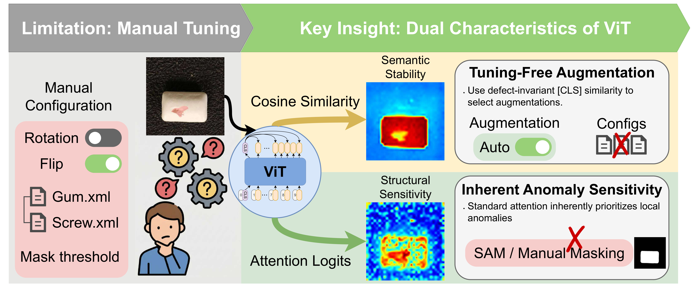
        </a>
        <figcaption><strong>Concept Teaser</strong> — 單一 <code>[CLS]</code> token 同時具備全域語意穩定性與局部結構敏感性</figcaption>
      </figure>
      <figure class="wk-plate">
        <a href="/assets/imgs/Papers/DuoAD/framework.jpg" class="wk-plate__frame">
          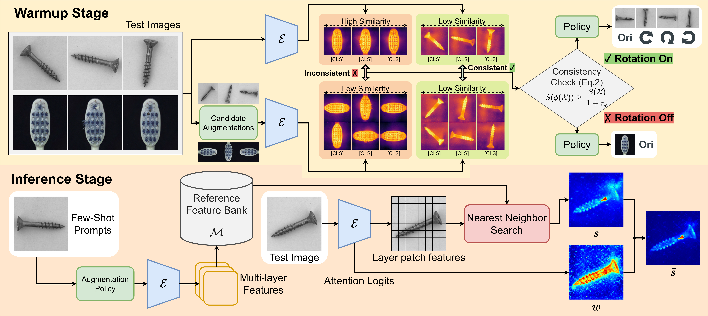
        </a>
        <figcaption><strong>Architecture Pipeline</strong> — Self-Calibrated Augmentation 與 Attention-Guided Reweighting</figcaption>
      </figure>
    

  

</section>

<!-- ========================================================================
     FLAGSHIP 02: LSSGEN (FULL-BLEED DEEP OCEAN-INK STAGE)
     ======================================================================== -->
<section class="wk-band wk-band--lssgen" id="lssgen-section" aria-labelledby="lssgen">
  

    

      

        

          <h2 id="lssgen" class="wk-flagship__name">LSSGen</h2>
          

            ICCVW 2025 · First Author
            Defect Synthesis Pipeline
          

        

        
Leveraging Latent Space Scaling in Flow and Diffusion for Efficient Text-to-Image Generation

        
順應 Diffusion 與 Flow 模型由粗到細（coarse-to-fine）的去噪特性，將前期高冗餘的擴散步驟移至低解析度潛空間執行，搭配輕量 Latent Upsampler Adapter 跨模型複用。在維持高解析度結構與紋理細節的同時實現 1.5× 加速，並已導入內部瑕疵影像合成流程。

      

      

        

          <a href="https://imrton.github.io/%E8%AB%96%E6%96%87/LSSGen/" class="wk-btn wk-btn--cyan">Project Page</a>
          <a href="https://arxiv.org/abs/2507.16154" class="wk-btn wk-btn--dark-outline">arXiv</a>
          <a href="https://github.com/inventec-ai-center/LSSGen" class="wk-btn wk-btn--dark-outline">GitHub</a>
        

        <ul class="wk-skill-row wk-skill-row--dark" aria-label="LSSGen 核心技術">
          <li>Diffusion &amp; Flow</li>
          <li>DiT / UNet</li>
          <li>Diffusers</li>
          <li>Latent Scaling</li>
          <li>Inference Acceleration</li>
        </ul>
      

    

    

      

        

          
          <h3>Inference Speedup · FLUX.1-dev High-Res Generation</h3>
        

        

          

            <strong class="wk-metric__val wk-metric__val--cyan">1.5×</strong>
            端到端生成速度提升
          

          

            <strong class="wk-metric__val wk-metric__val--cyan">54s → 36s</strong>
            較 FLUX.1-dev 顯著縮短耗時
          

          

            <strong class="wk-metric__val wk-metric__val--cyan">1/16×</strong>
            ½ 解析度單步注意力運算量
          

        

      

      

        

          
          <h3>Adapter Compatibility · 跨架構通用複用</h3>
        

        

          

            <strong class="wk-metric__val wk-metric__val--cyan">~500K</strong>
            單一 VAE 輕量 Adapter 參數
          

          

            <strong class="wk-metric__val wk-metric__val--cyan">DiT &amp; UNet</strong>
            免重訓大型 Backbone 直接套用
          

          

            <strong class="wk-metric__val wk-metric__val--cyan">Full Fidelity</strong>
            維持高解析度結構與細節品質
          

        

      

    

    

      <figure class="wk-plate">
        <a href="/assets/imgs/Papers/LSSGen/teaser.jpg" class="wk-plate__frame">
          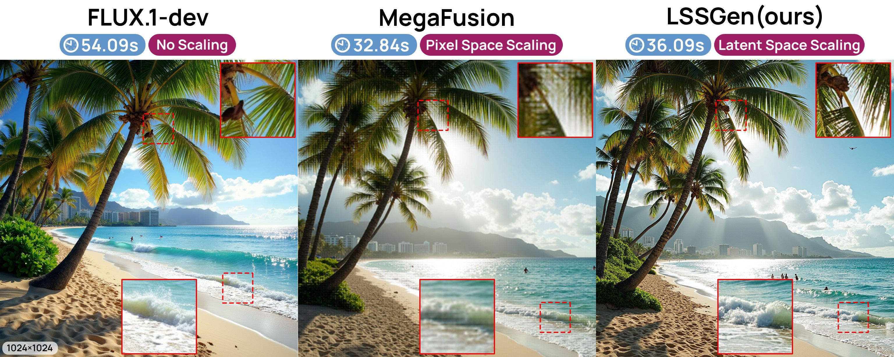
        </a>
        <figcaption><strong>Quality &amp; Speed Benchmark</strong> — FLUX.1-dev vs. MegaFusion vs. LSSGen（Ours）</figcaption>
      </figure>
      <figure class="wk-plate">
        <a href="/assets/imgs/Papers/LSSGen/DynaFlow_v3.jpg" class="wk-plate__frame">
          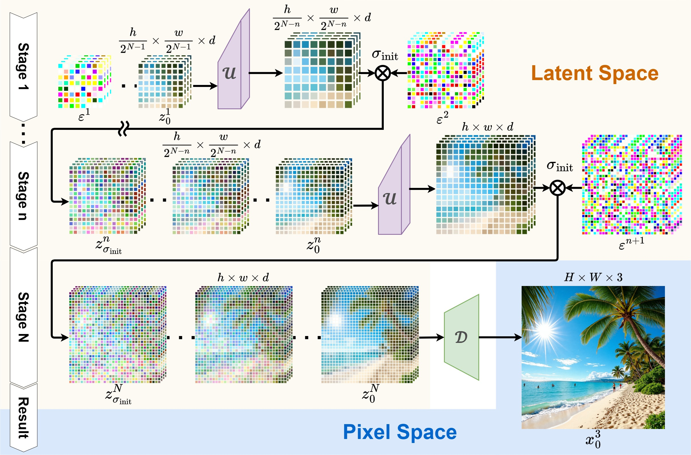
        </a>
        <figcaption><strong>Multi-Stage Scaling Flow</strong> — Latent Space Scaling 多階段生成流程架構</figcaption>
      </figure>
    

  

</section>

<!-- ========================================================================
     CHAPTER 2: APPLIED AI & RESEARCH PROJECTS (WARM ALABASTER)
     ======================================================================== -->
<section class="wk-band wk-band--alabaster" id="applied-ai" aria-labelledby="heading-applied-ai">
  

    

      <h2 id="heading-applied-ai">Applied AI &amp; Research</h2>
      
涵蓋碩士論文研究、Skywatch 實習演算法開發、語意檢索與輕量 LLM 微調部署，每項皆為可驗證的端到端實作。

    

    

      <article class="wk-card wk-card--wide wk-card--contain">
        

          

            <h3>漫畫修補 (Inpainting) &amp; 漫畫復原 (Restoration)</h3>
            
NTUST 碩士論文 · User Study 優於 LaMa、Stable Diffusion 與 Xie et al.

          

          2024
        

        
針對 Latent Diffusion 應用於黑白漫畫修補時的結構失真問題進行改良，並設計對稱式 Symmetric VAE 有效去除老化紙本漫畫的髒污與泛黃特徵。

        <figure class="wk-media wk-media--panorama">
          <a href="/assets/imgs/Projects/Software/AI/MDIM/Inpainting.jpg">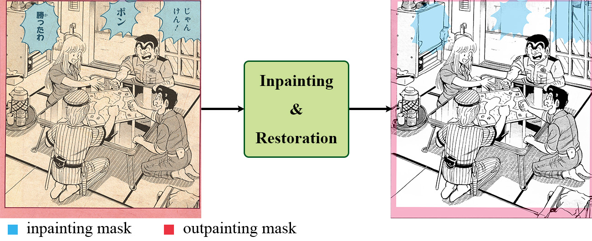</a>
          <figcaption>圖中影像來自漫畫烏龍派出所©</figcaption>
        </figure>
        

          <ul class="wk-skill-row">
            <li>Latent Diffusion</li>
            <li>Symmetric VAE</li>
            <li>Image Restoration</li>
            <li>PyTorch</li>
          </ul>
          

            <a href="https://imrton.github.io/%E5%B0%88%E6%A1%88/MangaInpainting/" class="wk-link-inline">Project Page →</a>
          

        

      </article>

      <article class="wk-card wk-card--contain">
        

          

            <h3>Ti-MAE &amp; Transformer</h3>
            
從零手刻時間序列自監督學習架構與隨機遮罩訓練流程

          

          Paper Reimpl.
        

        
參考 Ti-MAE 論文，使用 PyTorch Lightning 從頭實作 Transformer 與 Masked Autoencoder，進行時間序列特徵表徵學習與分類。

        <figure class="wk-media">
          <a href="/assets/imgs/Projects/Software/AI/TiMAE/TiMAE_Architecture.png">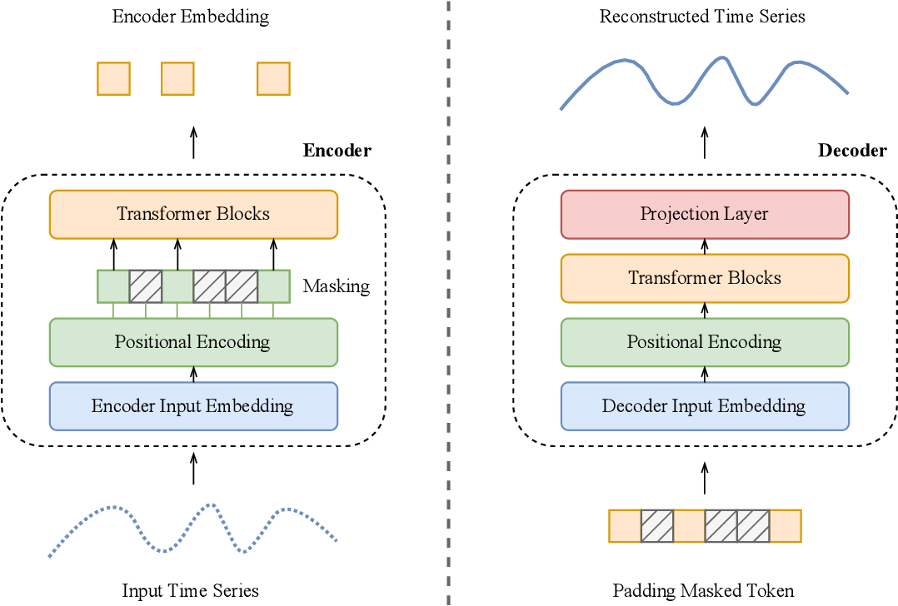</a>
        </figure>
        

          <ul class="wk-skill-row">
            <li>PyTorch Lightning</li>
            <li>Transformer</li>
            <li>Self-Supervised</li>
          </ul>
          

            <a href="https://github.com/ImRTon/TiMAE-Lightning" class="wk-link-inline">Source Code →</a>
          

        

      </article>

      <article class="wk-card">
        

          

            <h3>AI Smart Fast Forward</h3>
            
24 小時監控影像濃縮至 10 分鐘 · 降噪與 C++ 效能最佳化

          

          Skywatch · 2023
        

        
於 Skywatch 實習期間，為智慧縮時演算法導入 AI 降低環境雜訊敏感度，並同步最佳化 C++ 運算流程，顯著改善執行時間與記憶體消耗。

        <figure class="wk-media">
          <a href="/assets/imgs/Projects/Software/SmartFF/SmartFF.jpg">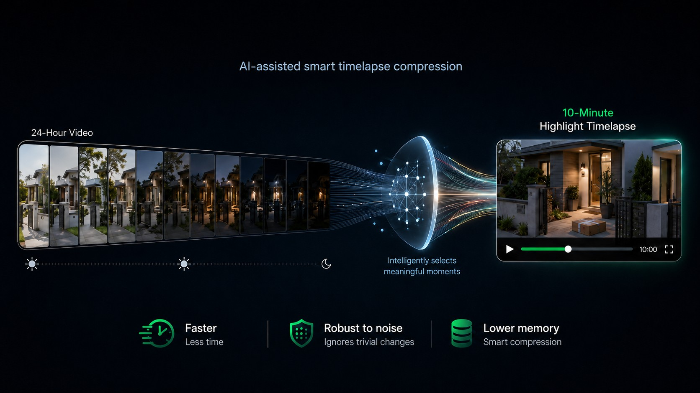</a>
        </figure>
        

          <ul class="wk-skill-row">
            <li>C++</li>
            <li>Video Analysis</li>
            <li>Edge Optimization</li>
          </ul>
        

      </article>

      <article class="wk-card">
        

          

            <h3>Image Similarity &amp; Semantic Search</h3>
            
支援以文搜圖與以圖搜圖的跨模態向量檢索原型

          

          2024
        

        
結合 CLIP 多模態特徵編碼與 Milvus Vector Database，打造可即時輸入自然語言描述或上傳圖片進行語意與視覺相似搜尋的系統。

        <figure class="wk-media">
          
        </figure>
        

          <ul class="wk-skill-row">
            <li>CLIP</li>
            <li>Milvus Vector DB</li>
            <li>Semantic Search</li>
          </ul>
          

            <a href="https://imrton.github.io/%E5%B0%88%E6%A1%88/ImageSimilaritySearch/" class="wk-link-inline">Project Page →</a>
          

        

      </article>

      <article class="wk-card wk-card--contain">
        

          

            <h3>Skywatch 產品 QA 機器人</h3>
            
消費級 RTX 2070 8GB 部署 7B LLM · QLoRA 領域微調

          

          Skywatch · 2023
        

        
以 GPT-4 合成產品問答資料集，透過 Supervised Fine-tuning 與 QLoRA 微調 Taiwan-LLM-7B（Llama 2 基礎），在有限顯存下完成專屬客服問答部署。

        <figure class="wk-media wk-media--dark wk-media--qa">
          <a href="/assets/imgs/Projects/Software/AI/LLM/Skywatch-LLM/QA1.png">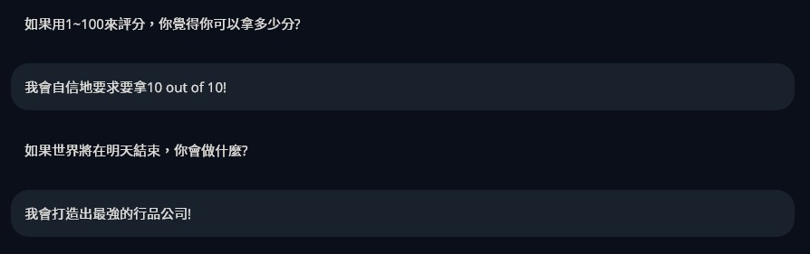</a>
          
        </figure>
        

          <ul class="wk-skill-row">
            <li>Llama 2</li>
            <li>QLoRA</li>
            <li>LLM Fine-Tuning</li>
          </ul>
        

      </article>

      <article class="wk-card wk-card--contain">
        

          

            <h3>漫畫畫格與對話框實例切割</h3>
            
自動精準分離複雜漫畫版面中的 Panel 與 Speech Bubble

          

          Research
        

        
以 Detectron2 訓練 MViT 骨幹之 Instance Segmentation 模型，作為自動化漫畫理解與修補管線的前處理基礎。

        <figure class="wk-media wk-media--two wk-media--portrait">
          
          
          <figcaption>圖中影像來自漫畫烏龍派出所©</figcaption>
        </figure>
        

          <ul class="wk-skill-row">
            <li>MViT</li>
            <li>Detectron2</li>
            <li>Instance Segmentation</li>
          </ul>
        

      </article>

      <article class="wk-card wk-card--contain">
        

          

            <h3>Car Detection &amp; Removal of Landscape Scene</h3>
            
車輛辨識率近 99% · 2D Mask 投影至 3D 重建場景去除動態雜物

          

          大學專題
        

        
以 Mask R-CNN 偵測空拍影像中的車輛與雜物，結合相機外參將 2D 遮罩投影回 3D 場景重建流程，產出乾淨無鬼影的街道模型。

        <figure class="wk-media wk-media--poster">
          
        </figure>
        

          <ul class="wk-skill-row">
            <li>Mask R-CNN</li>
            <li>Blender</li>
            <li>2D-to-3D Projection</li>
          </ul>
          

            <a href="/assets/imgs/Projects/Software/AI/110_%E5%9C%B0%E6%99%AF%E8%BB%8A%E8%BC%9B%E5%B0%88%E9%A1%8C%E6%B5%B7%E5%A0%B1.jpg" class="wk-link-inline">查看完整海報 →</a>
          

        

      </article>
    

    

      

        

          <strong>DLCV Coursework Archive</strong>
          深度學習與電腦視覺課程實作（CNN、GAN、Diffusion、CLIP、NeRF · 2022）
        

        展開
      

      

        

          <article class="wk-card">
            

              <h3>CNN &amp; Semantic Segmentation</h3>
              2022
            

            
CNN 特徵空間 t-SNE 視覺化分析與衛星影像語意分割實作。

            <figure class="wk-media wk-media--two">
              <a href="/assets/imgs/Projects/Software/DLCV/tSNE.png">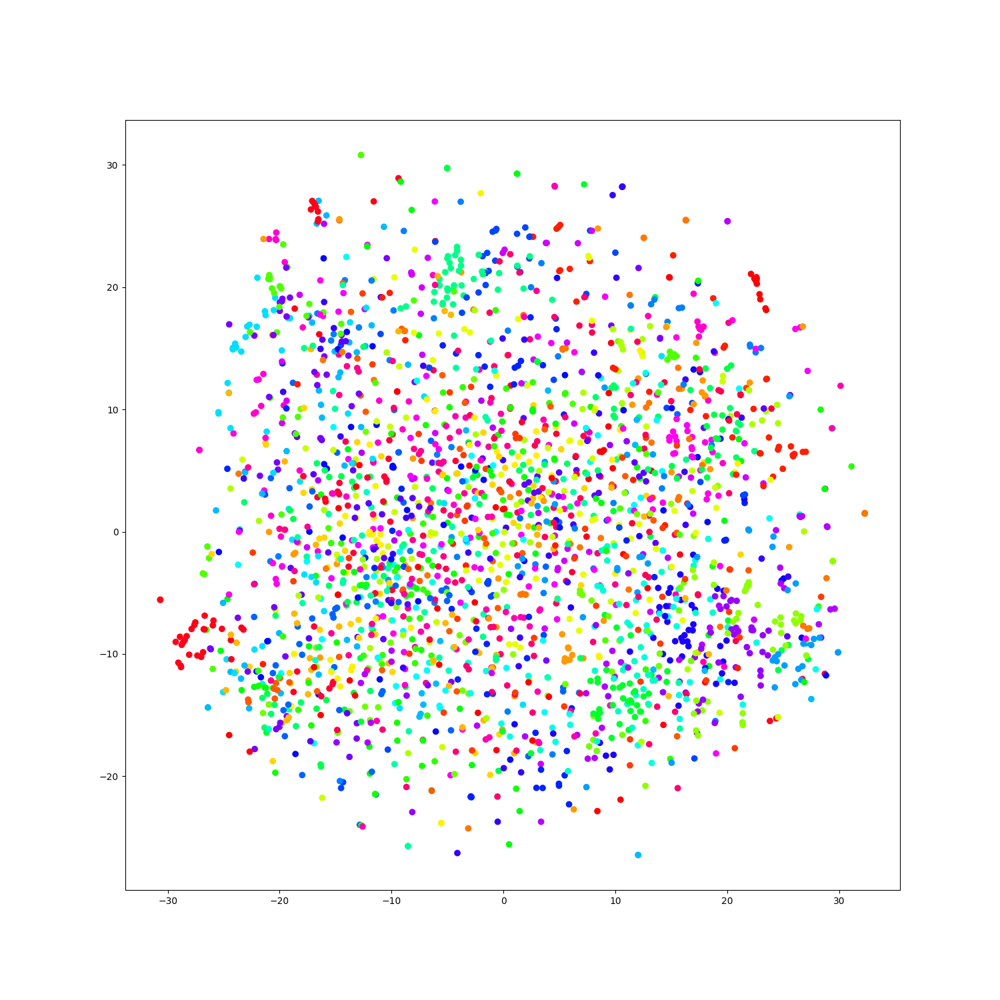</a>
              <a href="/assets/imgs/Projects/Software/DLCV/Semantic%20segmentation.jpg">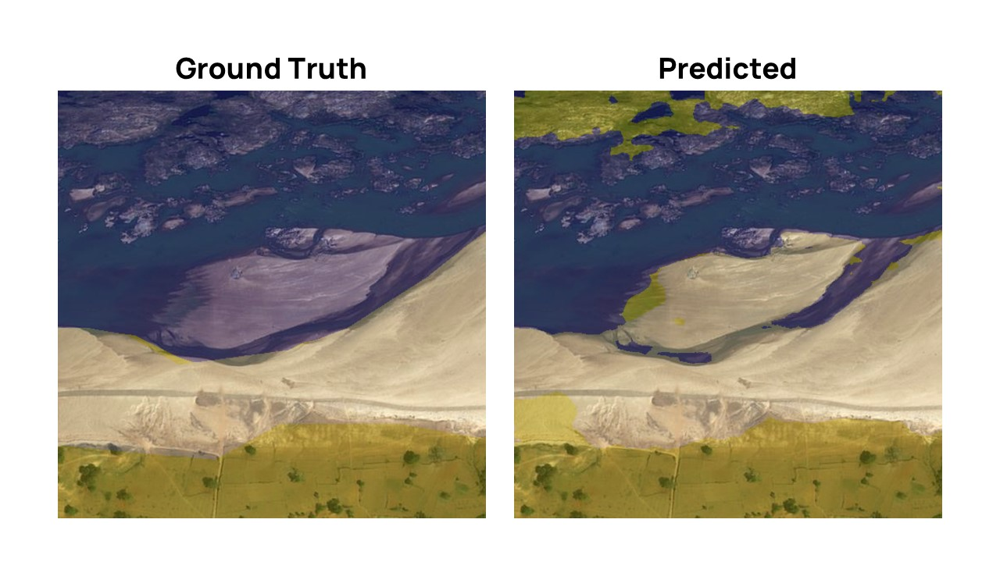</a>
            </figure>
            

              <ul class="wk-skill-row"><li>CNN</li><li>t-SNE</li><li>Segmentation</li></ul>
              
<a href="https://hackmd.io/@RTon/H1_Wtvcfs" class="wk-link-inline">Course Notes →</a>

            

          </article>

          <article class="wk-card wk-card--contain">
            

              <h3>CLIP &amp; Image Captioning</h3>
              CLIPScore 0.8990
            

            
Predicted: “a person standing on a beach with colorful kite .” / Ground Truth: “a man is walking towards his kite on the ground.”

            <figure class="wk-media">
              <a href="/assets/imgs/Projects/Software/DLCV/Caption_top_sourceImg.jpg">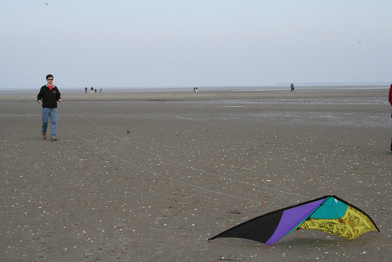</a>
            </figure>
            

              <ul class="wk-skill-row"><li>CLIP</li><li>Image Captioning</li></ul>
              
<a href="https://hackmd.io/@RTon/BkpQxeGHi" class="wk-link-inline">Course Notes →</a>

            

          </article>

          <article class="wk-card wk-card--contain">
            

              <h3>NeRF &amp; Self-Supervised Learning</h3>
              2022
            

            
DVGO（Direct Voxel Grid Optimization）新視角合成實作與渲染結果。

            <figure class="wk-media">
              
            </figure>
            

              <ul class="wk-skill-row"><li>NeRF</li><li>DVGO</li><li>3D Synthesis</li></ul>
              
<a href="https://hackmd.io/@RTon/H1YkYXjUj" class="wk-link-inline">Course Notes →</a>

            

          </article>

          <article class="wk-card wk-card--contain">
            

              <h3>3D Semantic Segmentation</h3>
              DLCV Final
            

            
3D 點雲與場景語意分割期末專題海報。

            <figure class="wk-media wk-media--poster">
              
            </figure>
            

              <ul class="wk-skill-row"><li>3D Segmentation</li><li>Point Cloud</li></ul>
            

          </article>

          <article class="wk-card wk-card--wide wk-card--contain">
            

              <h3>DCGAN、WGAN、Diffusion Model &amp; DANN</h3>
              2022
            

            
人臉生成（DCGAN / WGAN）、MNIST Diffusion 生成，以及 MNIST-M → SVHN / USPS 領域適應（DANN）特徵對齊。

            <figure class="wk-media wk-media--three">
              <a href="/assets/imgs/Projects/Software/DLCV/DCGAN.png">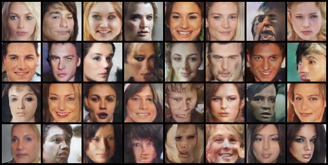</a>
              <a href="/assets/imgs/Projects/Software/DLCV/WGAN.png">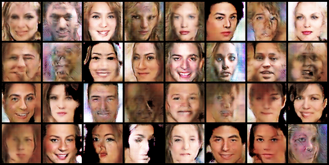</a>
              <a href="/assets/imgs/Projects/Software/DLCV/Diffusion.png">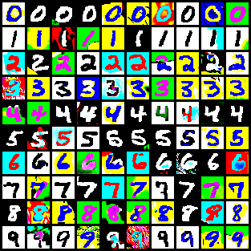</a>
            </figure>
            

              <ul class="wk-skill-row"><li>DCGAN</li><li>WGAN</li><li>Diffusion</li><li>DANN</li></ul>
              
<a href="https://hackmd.io/@RTon/SJw676wms" class="wk-link-inline">Course Notes →</a>

            

          </article>
        

      

    

  

</section>

<!-- ========================================================================
     CHAPTER 3: PERSONAL PRODUCTS (IMMERSIVE PRODUCT STAGES)
     ======================================================================== -->
<section class="wk-band wk-band--products" id="personal-products" aria-labelledby="heading-products">
  

    

      

        <h2 id="heading-products">Independent Products</h2>
        
結合 Agentic Engineering 工作流，從問題定義、UX 設計到原生 Android 程式碼架構獨立完成 0→1 交付。

      

    

  

  <!-- PRODUCT 01: HOW'S THE WEATHER (FULL-BLEED TAIWAN CARTOGRAPHIC RADAR STAGE) -->
  

    

      <svg class="wk-weather-map" viewBox="0 0 1440 760" preserveAspectRatio="xMidYMid slice" fill="none" xmlns="http://www.w3.org/2000/svg">
        <!-- Lat/Lon cartographic graticule -->
        <g class="wk-weather-map__grid" stroke="currentColor" stroke-width="1">
          <line x1="180" y1="0" x2="180" y2="760"/>
          <line x1="420" y1="0" x2="420" y2="760"/>
          <line x1="660" y1="0" x2="660" y2="760"/>
          <line x1="900" y1="0" x2="900" y2="760"/>
          <line x1="1140" y1="0" x2="1140" y2="760"/>
          <line x1="1380" y1="0" x2="1380" y2="760"/>
          <line x1="0" y1="130" x2="1440" y2="130"/>
          <line x1="0" y1="310" x2="1440" y2="310"/>
          <line x1="0" y1="490" x2="1440" y2="490"/>
          <line x1="0" y1="670" x2="1440" y2="670"/>
        </g>

        <!-- Taiwan main island silhouette + Central Mountain Range contours + outlying islands -->
        <g class="wk-weather-map__taiwan">
          <!-- Main Island Fill & Crisp Coastline -->
          <path class="wk-weather-map__island" d="M 978 136 C 992 136, 1008 144, 1024 156 C 1038 166, 1046 176, 1040 186 C 1029 198, 1018 206, 1019 222 C 1020 236, 1022 248, 1014 272 C 1005 298, 998 326, 991 356 C 984 386, 976 418, 966 448 C 956 476, 943 502, 934 528 C 926 552, 926 580, 923 604 C 921 614, 913 614, 910 603 C 908 594, 905 588, 902 595 C 899 601, 892 597, 891 584 C 889 564, 882 544, 871 524 C 858 500, 842 478, 833 450 C 824 422, 822 392, 827 360 C 832 328, 846 296, 864 266 C 882 236, 902 206, 924 182 C 942 162, 958 148, 968 140 C 972 137, 975 136, 978 136 Z"/>
          <!-- Central Mountain Range inner elevation contours -->
          <path class="wk-weather-map__ridge" d="M 986 196 C 998 228, 992 274, 979 324 C 966 374, 949 428, 928 474 C 912 508, 898 518, 892 492 C 886 466, 886 416, 898 362 C 910 308, 932 252, 956 214 C 968 195, 979 182, 986 196 Z"/>
          <path class="wk-weather-map__ridge" d="M 970 256 C 974 288, 966 332, 954 374 C 942 414, 926 446, 916 436 C 907 426, 910 384, 922 340 C 934 296, 952 258, 964 248 C 968 245, 969 249, 970 256 Z"/>
          <!-- Penghu Islands -->
          <path class="wk-weather-map__island" d="M 766 404 C 771 399, 779 401, 780 408 C 781 414, 775 419, 769 417 C 764 415, 762 409, 766 404 Z"/>
          <circle class="wk-weather-map__island" cx="760" cy="426" r="3.2"/>
          <circle class="wk-weather-map__island" cx="774" cy="430" r="2.4"/>
          <!-- Guishan, Green Island, Orchid Island, Xiaoliuqiu -->
          <circle class="wk-weather-map__island" cx="1046" cy="204" r="3.2"/>
          <circle class="wk-weather-map__island" cx="998" cy="496" r="3.8"/>
          <circle class="wk-weather-map__island" cx="994" cy="560" r="5"/>
          <circle class="wk-weather-map__island" cx="850" cy="534" r="2.8"/>
        </g>

        <!-- Concentric Doppler radar range rings centered over Taiwan -->
        <g class="wk-weather-map__rings" stroke="currentColor" stroke-width="1">
          <circle cx="932" cy="368" r="118"/>
          <circle cx="932" cy="368" r="228" stroke-dasharray="5 7"/>
          <circle cx="932" cy="368" r="342"/>
          <circle cx="932" cy="368" r="468" stroke-dasharray="3 9"/>
          <!-- Radar station crosshair -->
          <line x1="920" y1="368" x2="944" y2="368"/>
          <line x1="932" y1="356" x2="932" y2="380"/>
          <circle cx="932" cy="368" r="3.5" fill="currentColor"/>
        </g>
      </svg>

      <canvas class="wk-weather-canvas" data-weather-canvas></canvas>
      

      

        23.70°N · 121.00°E · CWA RADAR
        
          dBZ
          
        
      

    

    

      <article class="wk-product-split">
        

          

            <h3>How’s the Weather</h3>
            Android App · 0→1
          

          
為台灣日常移動打造的視覺化天氣判讀 App。

          
先用直覺摘要抓住出門重點，再把雷達迴波、累積雨量、雲層與風場直接疊合在互動地圖上。不讓冰冷的降雨機率替你做決定，而是讓你親眼看見天氣動態，自信判斷現在是否適合出門。

          <ul class="wk-feature-list">
            <li><strong>出門決策摘要卡</strong> — 一眼掌握當前降雨趨勢與溫濕體感</li>
            <li><strong>多圖層互動雷達地圖</strong> — 疊加雷達迴波、未來雨量、雲層與風場</li>
            <li><strong>在地微氣候串接</strong> — 直接整合中央氣象署 CWA 開放資料</li>
          </ul>
          <ul class="wk-skill-row" aria-label="How's the Weather 技術棧">
            <li>Kotlin</li>
            <li>Jetpack Compose</li>
            <li>Google Maps</li>
            <li>CWA Open Data</li>
            <li>Agentic Workflow</li>
          </ul>
          

            <a href="https://github.com/ImRTon/Hows-The-Weather" class="wk-btn wk-btn--weather">GitHub · Source Code</a>
          

        

        

          <figure class="wk-phone">
            
            <figcaption>出門決策卡與雷達迴波</figcaption>
          </figure>
          <figure class="wk-phone">
            
            <figcaption>累積雨量與時序預報</figcaption>
          </figure>
        

      </article>
    

  

  <!-- PRODUCT 02: EXPENSE BUCKET (INTERACTIVE LIQUID VESSEL STAGE) -->
  

    

      

        

          <canvas class="wk-bucket-canvas" data-bucket-canvas></canvas>
          

          <ol class="wk-bucket-scale">
            <li>100%</li>
            <li>75%</li>
            <li>50%</li>
            <li>25%</li>
          </ol>
        

        

          
            
            BUDGET LEVEL
            <strong data-bucket-pct>46%</strong>
          
          <button type="button" class="wk-bucket-gyro" data-bucket-gyro hidden>
            <svg viewBox="0 0 20 20" width="14" height="14" fill="none" stroke="currentColor" stroke-width="1.8" stroke-linecap="round" stroke-linejoin="round" aria-hidden="true">
              <circle cx="10" cy="10" r="7.5"/>
              <ellipse cx="10" cy="10" rx="7.5" ry="3"/>
              <circle cx="10" cy="10" r="1.5" fill="currentColor" stroke="none"/>
            </svg>
            啟用體感水位
          </button>
        

        <article class="wk-product-split wk-product-split--reverse wk-stage__inner">
          

            

              <h3>Expense Bucket</h3>
              Android App · 0→1
            

            
結合通知辨識與發票掃描的智慧預算記帳 App。

            
為日常消費與跨國旅行打造的原生記帳工具。自動從刷卡消費通知與電子發票 QR Code 建立可編輯草稿，大幅減少手動輸入負擔，同時保留每一筆交易與預算分配的最終控制權。

            <ul class="wk-feature-list">
              <li><strong>自動消費擷取</strong> — 偵測 Android 通知與電子發票 QR Code 建立草稿</li>
              <li><strong>信用卡回饋追蹤</strong> — 即時計算各卡回饋規則與每月回饋上限</li>
              <li><strong>多幣別旅遊帳本</strong> — 獨立專案預算管理與即時匯率換算</li>
            </ul>
            <ul class="wk-skill-row" aria-label="Expense Bucket 技術棧">
              <li>Kotlin</li>
              <li>Jetpack Compose</li>
              <li>Room</li>
              <li>CameraX</li>
              <li>ML Kit</li>
              <li>Agentic Workflow</li>
            </ul>
            

              <a href="https://github.com/ImRTon/Expense-Bucket" class="wk-btn wk-btn--ink">GitHub · Source Code</a>
            

          

          

            <figure class="wk-phone">
              
              <figcaption>月預算水位與明細</figcaption>
            </figure>
            <figure class="wk-phone">
              
              <figcaption>通知自動偵測草稿</figcaption>
            </figure>
            <figure class="wk-phone">
              
              <figcaption>多幣別旅遊專案預算</figcaption>
            </figure>
          

        </article>
      

    

  

</section>

<!-- ========================================================================
     CHAPTER 4: VISUAL & INTERACTIVE (PURE WHITE GALLERY)
     ======================================================================== -->
<section class="wk-band wk-band--white" id="visual-interactive" aria-labelledby="heading-visual">
  

    

      <h2 id="heading-visual">Visual &amp; Interactive</h2>
      
從光線追蹤、計算攝影與 OpenGL 底層渲染管線，到即時 3D 互動與遊戲引擎實作。

    

    

      <article class="wk-card wk-card--wide">
        

          

            <h3>Image Stitching Panorama</h3>
            
SIFT 特徵配對 × Multi-Band Blending 拼接高解析度台北 101 夜景全景

          

          VFX · 2022
        

        
實作完整全景拼接管線：SIFT 特徵偵測與配對、RANSAC 對齊、影像 warping、resampling 與多頻帶無縫融合。

        <figure class="wk-media wk-media--panorama-cover">
          <a href="/assets/imgs/Projects/Software/VFX/PR2_ImageStitching/Results/101.jpg">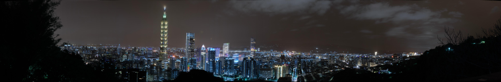</a>
        </figure>
        

          <ul class="wk-skill-row">
            <li>SIFT</li>
            <li>Feature Matching</li>
            <li>Warping &amp; Blending</li>
            <li>Python / OpenCV</li>
          </ul>
          

            <a href="https://imrton.github.io/%E5%B0%88%E6%A1%88/ImageStitching/" class="wk-link-inline">Project Page →</a>
            <a href="https://github.com/ImRTon/VFX-ImageStitching" class="wk-link-inline">Source Code →</a>
          

        

      </article>

      <article class="wk-card">
        

          

            <h3>High Dynamic Range Imaging</h3>
            
MTB 曝光對齊、相機反應曲線求解與 Tone Mapping 重建象山夜景

          

          VFX · 2022
        

        <figure class="wk-media wk-media--3-2">
          
        </figure>
        

          <ul class="wk-skill-row">
            <li>MTB Alignment</li>
            <li>Radiance Map</li>
            <li>Tone Mapping</li>
          </ul>
          

            <a href="https://imrton.github.io/%E5%B0%88%E6%A1%88/HDRImaging/" class="wk-link-inline">Project Page →</a>
            <a href="https://github.com/ImRTon/HighDynamicRange-Imaging" class="wk-link-inline">Source Code →</a>
          

        

      </article>

      <article class="wk-card">
        

          

            <h3>Incremental Instant Radiosity</h3>
            
Unity 即時全域間接光照渲染實作

          

          Graphics
        

        <figure class="wk-media wk-media--3-2">
          <a href="/assets/imgs/Projects/Software/3DGame/IncrementalInstantRadiosity.jpg">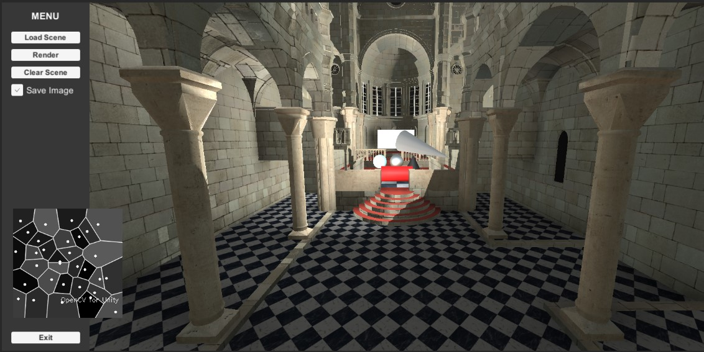</a>
        </figure>
        

          <ul class="wk-skill-row">
            <li>Unity Engine</li>
            <li>Ray Tracing</li>
            <li>Global Illumination</li>
          </ul>
          

            <a href="https://github.com/ImRTon/Incremental-Instant-Radiosity" class="wk-link-inline">Source Code →</a>
          

        

      </article>

      <article class="wk-card">
        

          

            <h3>Interactive Pailou Modeling</h3>
            
參數化即時生成傳統中式牌樓 3D 幾何結構

          

          Graphics
        

        <figure class="wk-media wk-media--16-9">
          <a href="/assets/imgs/Projects/Software/3DGame/InteractivePailouModeling.jpg">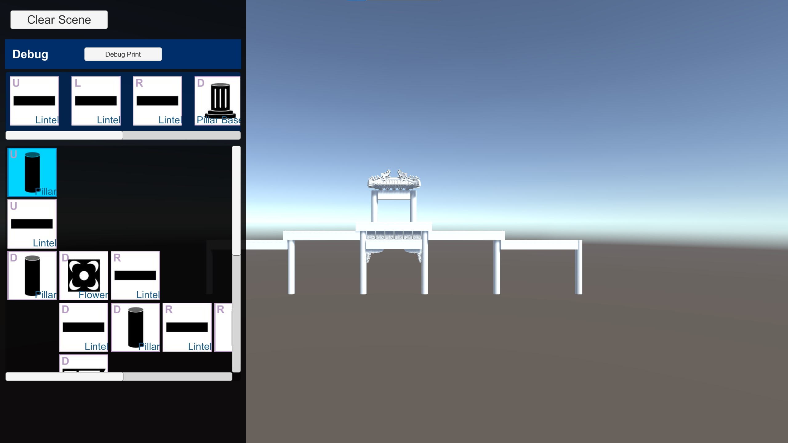</a>
        </figure>
        

          <ul class="wk-skill-row">
            <li>Unity Engine</li>
            <li>Procedural Modeling</li>
          </ul>
          

            <a href="https://github.com/ImRTon/InteractivePailouModeling" class="wk-link-inline">Source Code →</a>
          

        

      </article>

      <article class="wk-card">
        

          

            <h3>2D to 3D Maze</h3>
            
禁用 OpenGL Z-Buffer 手刻可見面判定與 3D 投影繪製

          

          Graphics
        

        <figure class="wk-media wk-media--16-9">
          <a href="/assets/imgs/Projects/Software/Graphics/Maze.png">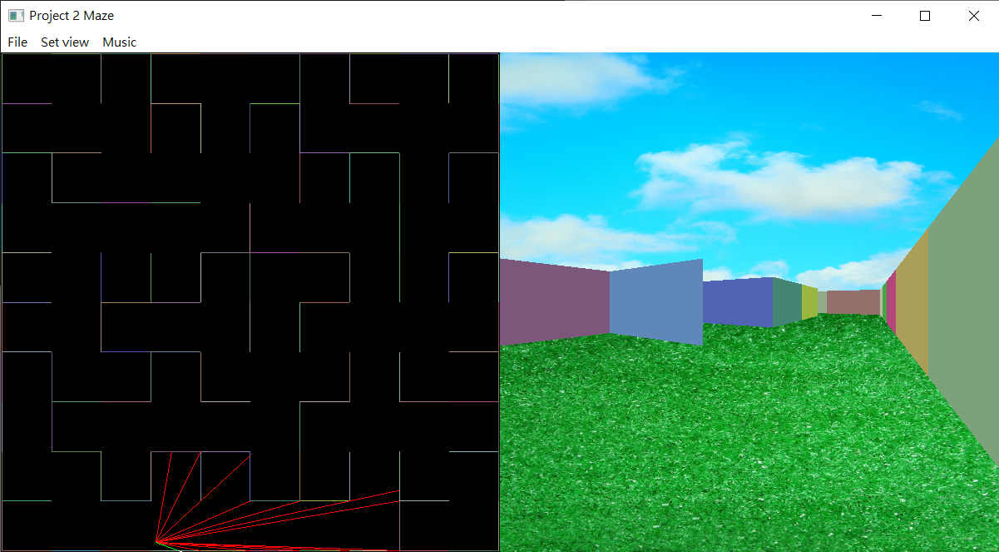</a>
        </figure>
        

          <ul class="wk-skill-row">
            <li>OpenGL</li>
            <li>C++</li>
            <li>Visible-Surface Determination</li>
          </ul>
        

      </article>

      <article class="wk-card">
        

          

            <h3>Tank Battle</h3>
            
第三人稱 3D 坦克對戰動作遊戲

          

          Game
        

        <figure class="wk-media wk-media--16-9">
          <a href="/assets/imgs/Projects/Software/Game/TankBattle.jpg">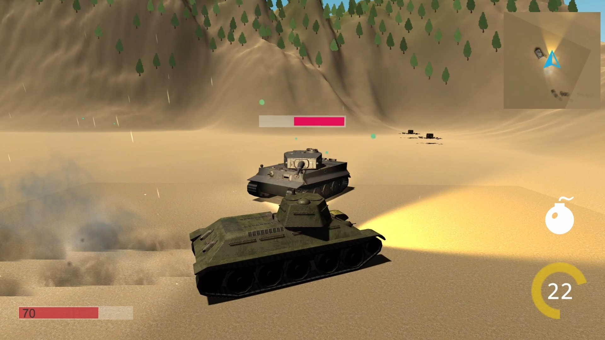</a>
        </figure>
        

          <ul class="wk-skill-row">
            <li>Unity Engine</li>
            <li>Third Person</li>
          </ul>
        

      </article>

      <article class="wk-card">
        

          

            <h3>Zombie Field 2022</h3>
            
Unreal Engine 4 第一人稱 3D 生存射擊遊戲

          

          Game
        

        <figure class="wk-media wk-media--two wk-media--16-9">
          <a href="/assets/imgs/Projects/Software/Game/ZombieField_1.png">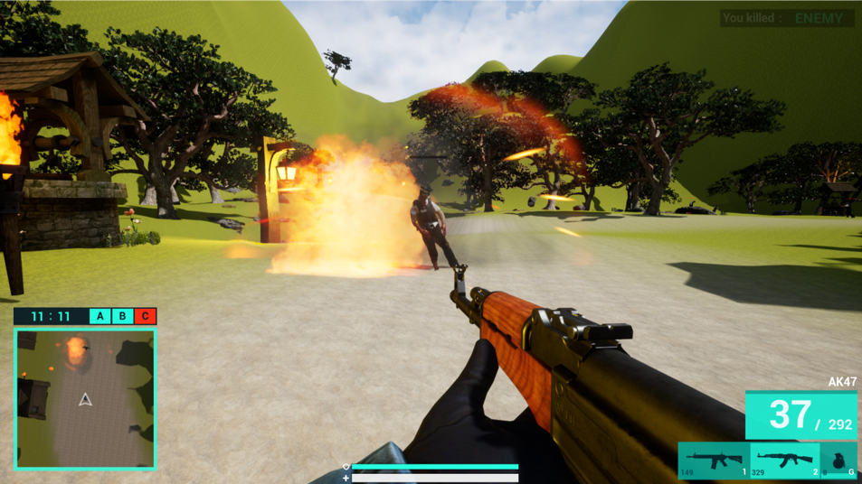</a>
          <a href="/assets/imgs/Projects/Software/Game/ZombieField_2.png">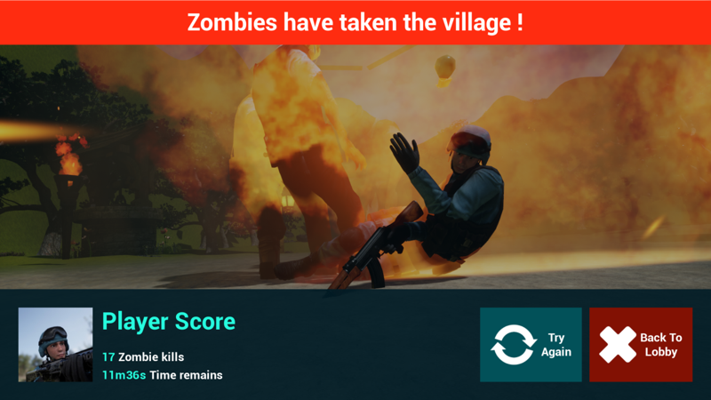</a>
        </figure>
        

          <ul class="wk-skill-row">
            <li>Unreal Engine 4</li>
            <li>FPS</li>
          </ul>
        

      </article>
    

  

</section>

<!-- ========================================================================
     CHAPTER 5: HARDWARE & PROTOTYPING (WARM ALABASTER)
     ======================================================================== -->
<section class="wk-band wk-band--alabaster" id="hardware-prototyping" aria-labelledby="heading-hardware">
  

    

      <h2 id="heading-hardware">Hardware &amp; Prototyping</h2>
      
結合機電整合、參數化 3D 建模列印與嵌入式電路設計，把日常觀察做成可實際騎乘、操作與迭代的實體。

    

    

      <article class="wk-card wk-card--wide">
        

          

            <h3>DIY Electric Scooter v4</h3>
            
全車重 &lt; 8 kg 可折疊輕量化電輔滑板車 · 模組化可抽換電池設計

          

          2021
        

        
以迪卡農 Town 7 XL 改造，自行設計馬達驅動結構與 3D 列印固定件，兼顧日常攜帶重量與快速換電補能。

        <figure class="wk-media wk-media--two wk-media--4-3">
          <a href="/assets/imgs/Projects/Hardware/ElectricScooterV4/P_20210821_160935.jpg">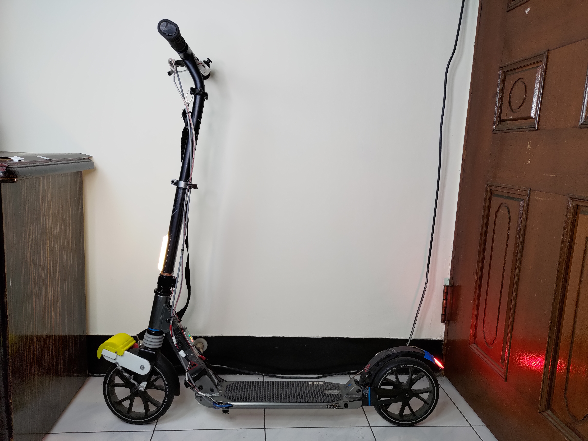</a>
          <a href="/assets/imgs/Projects/Hardware/ElectricScooterV4/P_20210821_160948.jpg">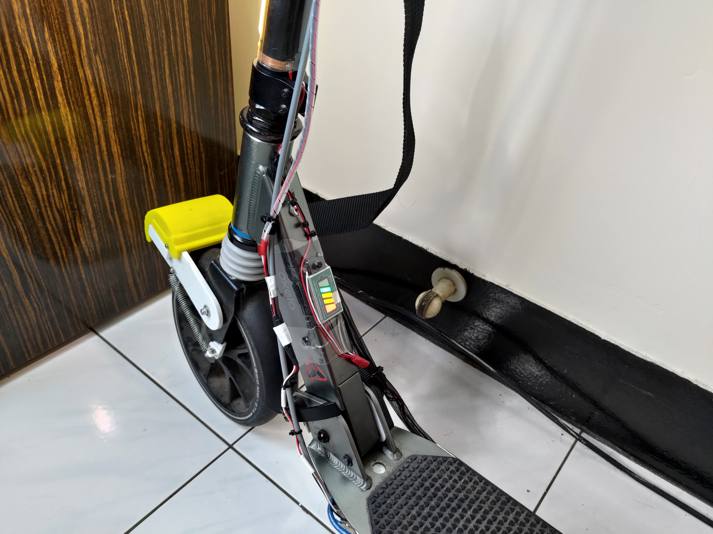</a>
        </figure>
        

          <ul class="wk-skill-row">
            <li>3D Printing</li>
            <li>Motor Control</li>
            <li>Electric Circuit</li>
            <li>Lithium Battery</li>
          </ul>
        

      </article>

      <article class="wk-card">
        

          

            <h3>Battery Pack of Electric Scooter</h3>
            
12V 6×20700B 鋰電系統 · 支援 60W PD 與 20W 快充輸出

          

          2021
        

        
專為電動滑板車打造的模組化可抽換電池組，整合 DC-DC 轉換電路，拆下即可作為大功率行動電源使用。

        <figure class="wk-media wk-media--4-3">
          <a href="/assets/imgs/Projects/Hardware/BatteryPackV1/P_20210821_161144.jpg">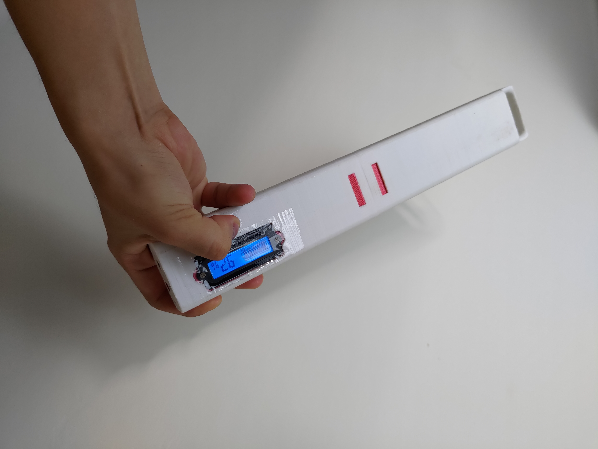</a>
        </figure>
        

          <ul class="wk-skill-row">
            <li>Lithium Battery</li>
            <li>DC-DC Circuit</li>
            <li>3D Printing</li>
          </ul>
        

      </article>

      <article class="wk-card">
        

          

            <h3>智慧約束帶 (創創 AIoT 2022)</h3>
            
創創 AIoT 2022 佳作 · 跨校醫護與機電合作降低壓瘡風險

          

          Award · 2022
        

        
與台科大醫工系及長庚科大護理系合作，透過氣囊、橫向電動馬達與 App 智慧調節患者約束受力分布。

        <figure class="wk-media wk-media--4-3">
          <a href="/assets/imgs/Projects/Hardware/AIoT_SmartHealth/IMG20220714162119.jpg">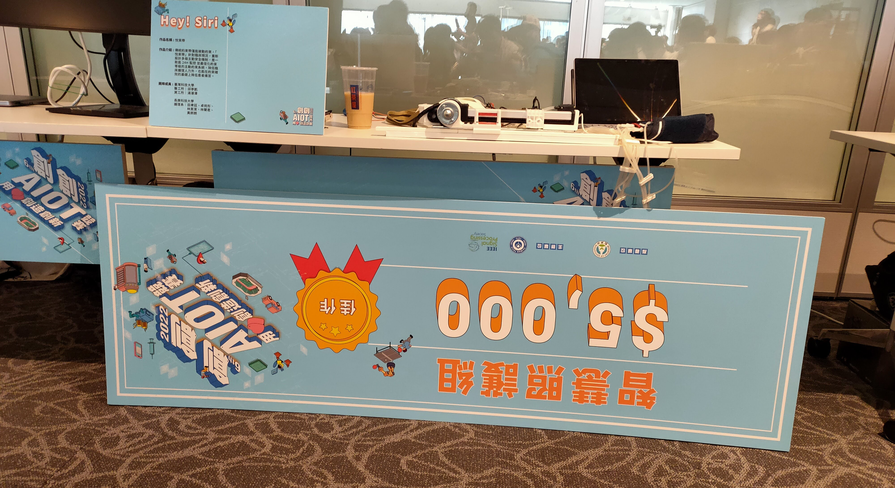</a>
        </figure>
        

          <ul class="wk-skill-row">
            <li>Arduino</li>
            <li>Smart Healthcare</li>
            <li>App Integration</li>
          </ul>
        

      </article>

      <article class="wk-card wk-card--wide">
        

          

            <h3>3D Printed KartRider Race Car</h3>
            
Autodesk Inventor 全零件參數化建模與高完成度 3D 列印組裝

          

          CAD · 3D Print
        

        <figure class="wk-media wk-media--three wk-media--4-3">
          <a href="/assets/imgs/Projects/Hardware/CarModel/CarFront.jpg">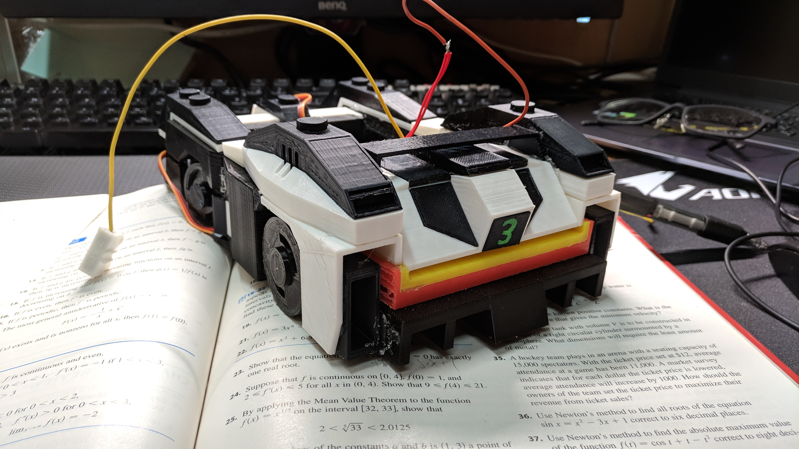</a>
          <a href="/assets/imgs/Projects/Hardware/CarModel/CarBack.jpg">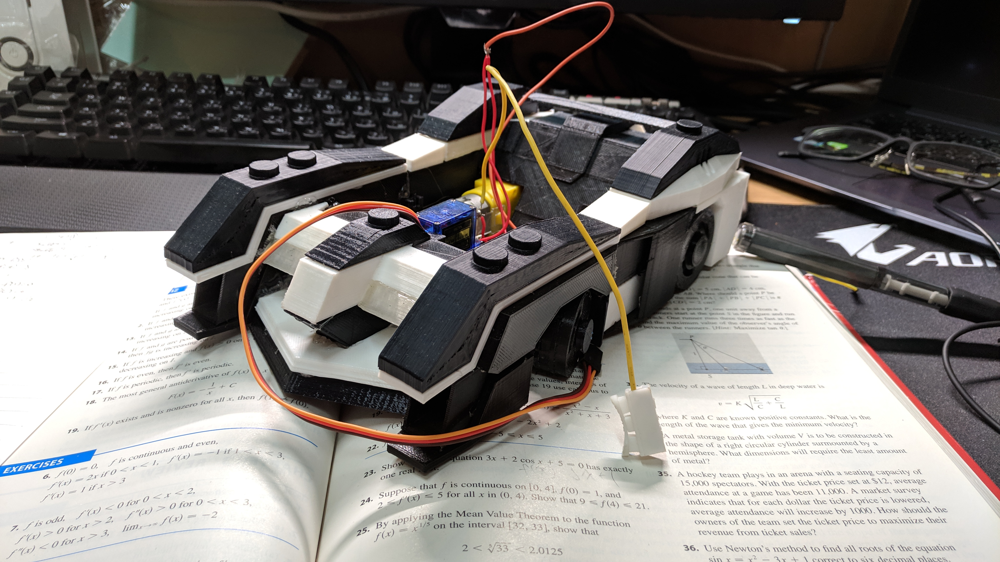</a>
          <a href="/assets/imgs/Projects/Hardware/CarModel/CarRendered.png">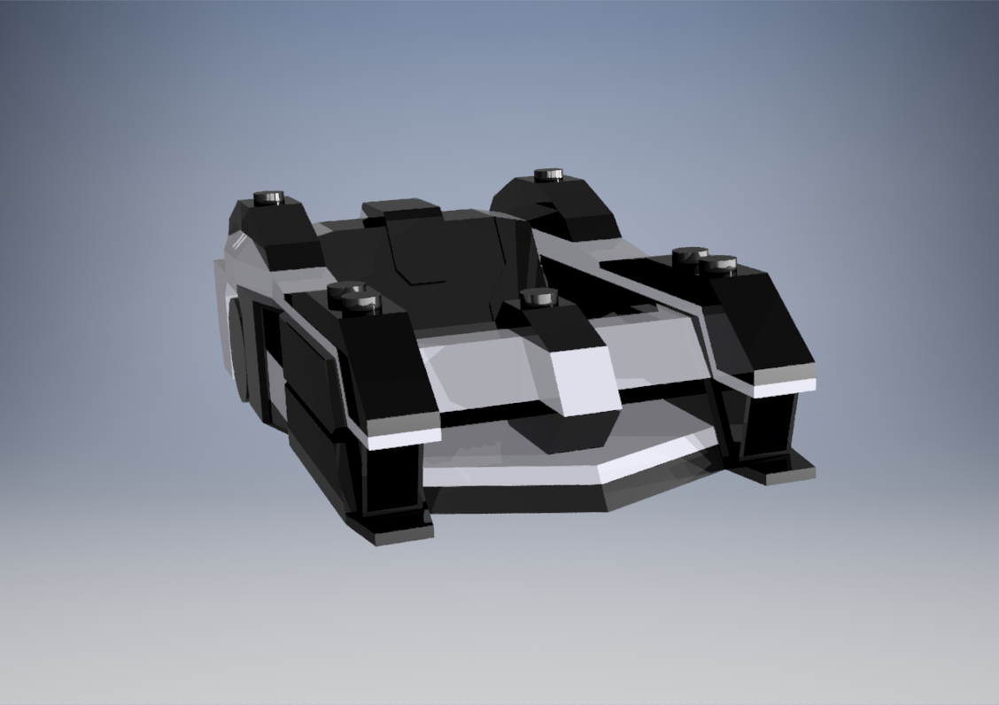</a>
        </figure>
        

          <ul class="wk-skill-row">
            <li>Autodesk Inventor</li>
            <li>3D Modeling</li>
            <li>3D Printing</li>
          </ul>
        

      </article>

      <article class="wk-card wk-card--wide">
        

          

            <h3>準時睡鬧鐘 (MakeNTU 2020)</h3>
            
24 小時黑客松實作 · 以「充電鎖定」與反向觸控筆引導準時入睡

          

          Hackathon · 2020
        

        
睡覺時間持續響鈴直到手機放入充電並鎖定至隔日鬧鐘，緊急情況可透過刻意提高操作門檻的反向觸控筆操作手機。

        <figure class="wk-media wk-media--three wk-media--4-3">
          <a href="/assets/imgs/Projects/Hardware/SleepNowAlarmClock/Clock_intro.jpg">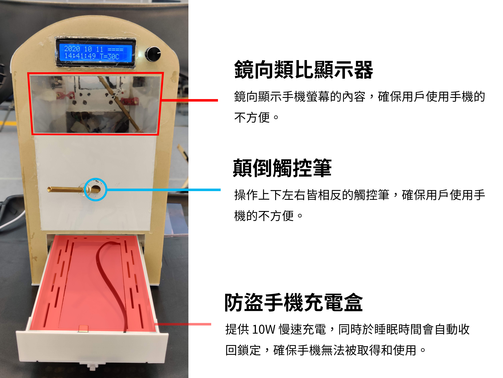</a>
          <a href="/assets/imgs/Projects/Hardware/SleepNowAlarmClock/IMG_20201011_144303.jpg">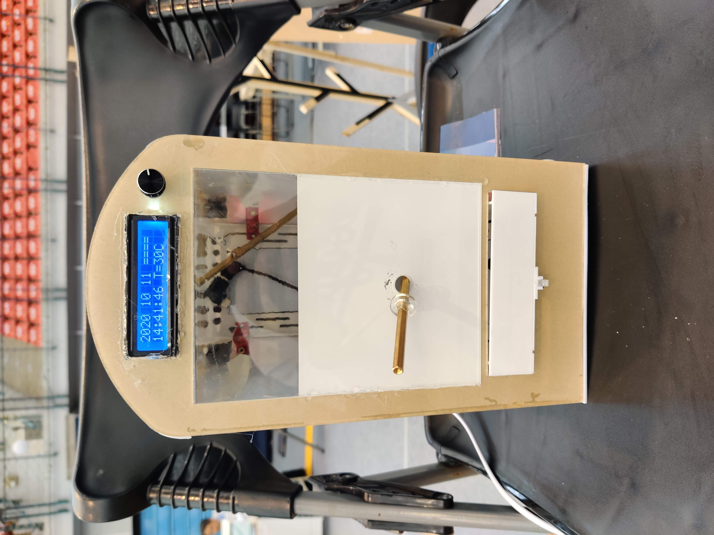</a>
          <a href="/assets/imgs/Projects/Hardware/SleepNowAlarmClock/IMG_20201011_144322.jpg">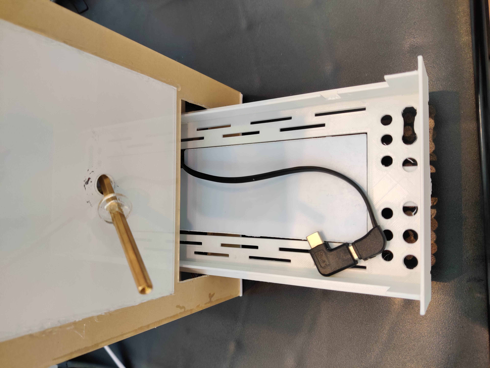</a>
        </figure>
        

          <ul class="wk-skill-row">
            <li>Arduino</li>
            <li>24h Hackathon</li>
            <li>Behavioral Design</li>
          </ul>
        

      </article>

      <article class="wk-card wk-card--wide">
        

          

            <h3>被窩空調 (綠色生活創意設計大賽)</h3>
            
綠色生活創意設計大賽 2019 佳作 · 水冷床墊局部溫控節能方案

          

          Award · 2019
        

        
與台科大電機及設計系合作，透過水冷管路床墊精準調節被窩微環境溫度，大幅降低整室空調耗能。

        <figure class="wk-media wk-media--three wk-media--4-3">
          <a href="/assets/imgs/Projects/Hardware/EMattress/IMG20191213092136.jpg">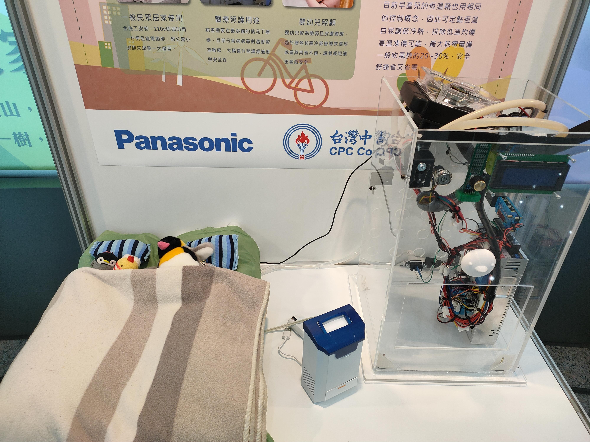</a>
          <a href="/assets/imgs/Projects/Hardware/EMattress/IMG20191208000646.jpg">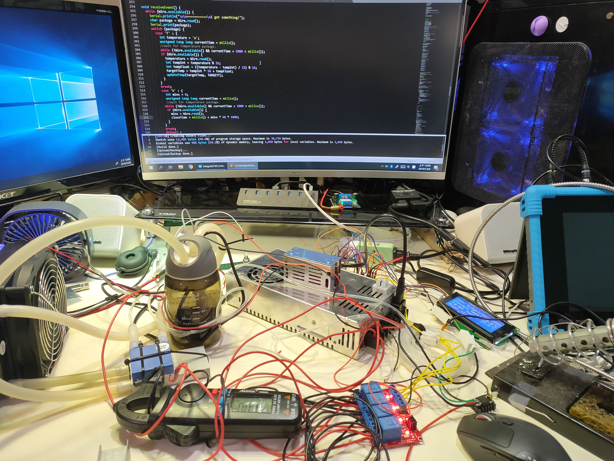</a>
          <a href="/assets/imgs/Projects/Hardware/EMattress/IMG20191212054916.jpg">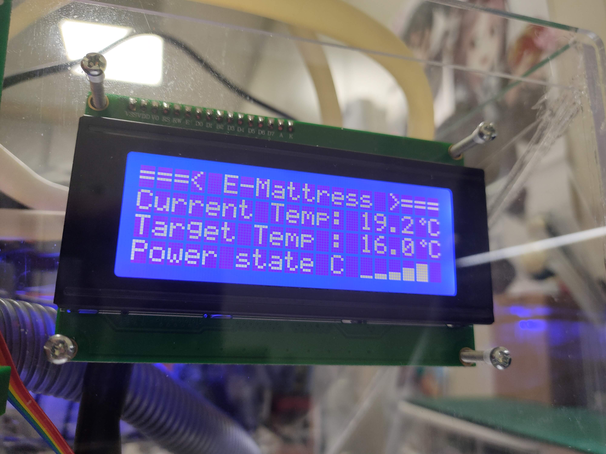</a>
        </figure>
        

          <ul class="wk-skill-row">
            <li>Arduino</li>
            <li>Thermal Control</li>
            <li>App</li>
          </ul>
        

      </article>

      <article class="wk-card wk-card--wide">
        

          

            <h3>動物森林 (互動桌遊)</h3>
            
工業設計 × 電機工程跨系合作 · RFID 實體卡牌音效互動主機

          

          Collaboration
        

        
負責機電系統實作與結構優化：主機透過 RFID 感應動物卡片，按下互動按鍵即觸發對應音效回饋。

        <figure class="wk-media wk-media--featured">
          
          <a href="/assets/imgs/Projects/Hardware/ForestBoardGame/AnimalForest_1.jpg">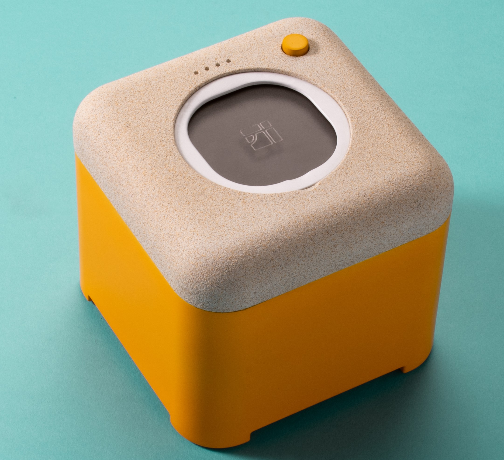</a>
          
        </figure>
        

          <ul class="wk-skill-row">
            <li>Arduino</li>
            <li>RFID</li>
            <li>3D Modeling &amp; Printing</li>
          </ul>
        

      </article>
    

  

</section>

<!-- ========================================================================
     CLOSING BAND (FULL-BLEED OBSIDIAN)
     ======================================================================== -->
<section class="wk-band wk-band--close" aria-label="履歷與聯絡方式">
  

    

      <h2>想進一步了解完整經歷、專利與產線系統架構？</h2>
      
包含 Agentic 檢測自動化平台、Diffusion 瑕疵合成技術指導、GPU 叢集維運與完整經歷細節。

    

    

      <a href="/about/" class="wk-btn wk-btn--white">前往關於我與完整經歷 →</a>
      <a href="https://github.com/ImRTon" class="wk-btn wk-btn--dark-outline">GitHub</a>
      <a href="https://www.linkedin.com/in/tang-nick" class="wk-btn wk-btn--dark-outline">LinkedIn</a>
      <a href="mailto:col360785@gmail.com" class="wk-btn wk-btn--dark-outline">Email</a>
    

  

</section>

<a href="#" class="works-top" aria-label="回到頁首"><svg viewBox="0 0 20 20" width="18" height="18" aria-hidden="true"><path d="M10 15V5M5.5 9.5 10 5l4.5 4.5" fill="none" stroke="currentColor" stroke-width="2.2" stroke-linecap="round" stroke-linejoin="round"/></svg></a>

