# DuoAD：Leveraging [CLS] Dual Characteristics for Training-Free Few-Shot Anomaly Detection
> 論文：[arXiv](https://arxiv.org/abs/2607.23924)  
> 程式：[GitHub](https://github.com/inventec-ai-center/DuoAD)

關鍵字：`AI`, `Anomaly Detection`, `Few-Shot`, `Training-Free`, `Vision Transformer`, `[CLS] Token`, `DINOv2`, `DINOv3`, `Industrial Inspection`  
論文作者：`Jyun-Ze Tang`, `Po-Han Huang`, `Ming-Ching Chang`, `Chih-Fan Hsu`, `Jeng-Lin Li`  
時間：2026 / 07 / 27

## 這篇論文在做什麼？
工業異常檢測通常要回答兩個問題：

1. 這張圖片有沒有瑕疵？
2. 瑕疵出現在什麼位置？

傳統 Unsupervised Anomaly Detection (AD) 會蒐集大量正常影像，針對特定資料集訓練模型。產線剛建立時，正常樣本往往很少，甚至只有一到四張可用參考圖。Few-shot anomaly detection 因此改用預訓練 vision foundation model，直接把少量正常影像建立成 feature memory bank，再以 feature distance 判斷測試影像是否偏離正常分布。

這類方法看起來很適合快速部署，實際使用時仍有兩個問題：

1. Augmentation policy 經常需要人工設定。螺絲可允許任意旋轉，但膠囊、電路板等具有固定方向的零件則可能因旋轉產生錯誤參考特徵。同一套 Rotation、flip policy 很難直接套用到所有類別。
2. Patch-based 方法通常把所有位置視為同等重要。物件、背景和瑕疵 Patch 都以相同規則進入 nearest-neighbor matching，模型缺少一個可靠的 global context 去判斷哪些空間位置更值得注意。

DuoAD 從 ViT 的 `[CLS]` token 找到兩個互補特性：

- **Semantic Stability**：`[CLS]` embedding 主要描述物件整體語意，對局部瑕疵相對穩定。
- **Structural Sensitivity**：`[CLS]` 到 patch tokens 的 pre-softmax attention logits 會對局部結構異常產生較高響應。

DuoAD 將兩個特性分別用在：

1. **Self-Calibrated Augmentation（SCA）**：根據未標註產線資料的 distribution consistency，自動決定哪些 augmentation 可以安全使用。
2. **Attention-Guided Feature Reweighting (Saliency)**：使用 `[CLS]` attention logits 對 patch anomaly scores 進行連續式加權，放大瑕疵區域並抑制背景。

再搭配 Multi-level features，整套方法不需要訓練 backbone，也不需要逐類別調整參數。

<figure>
    <a href="/assets/imgs/Papers/DuoAD/teaser.jpg">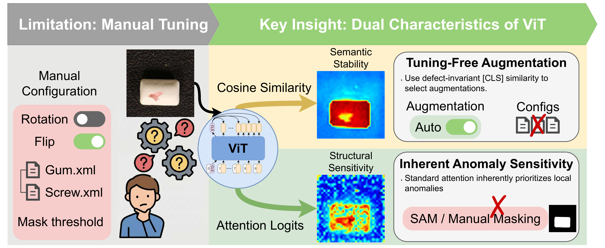</a>
    <figcaption>DuoAD 的核心概念。Semantic Stability 用來自動選擇 augmentation；Structural Sensitivity 用來建立連續式 Saliency weights，取代手動 mask threshold 與外部分割模型。</figcaption>
</figure>

## 這篇論文從哪裡開始？

DuoAD 的想法最初來自一個簡單的嘗試：能不能用 `[CLS]` token 與各個 patch tokens 的相似度來建立一張 Saliency map，把背景濾掉、讓前景與瑕疵得到更多關注？

### 第一個嘗試：CLS–Patch Cosine Similarity
直覺上，`[CLS]` 聚集整張圖的 global semantics，因此與 `[CLS]` 高度相似的 patch 應該屬於前景，低相似度的則可能是背景。這個假設確實能區分物件與背景，但也暴露一個問題：`[CLS]` embedding 對局部異常非常不敏感。結果是 Cosine similarity 會把異常 patch 當成背景，給予較低權重，導致加權的假設失效。但另一個想法就是既然比較低，能不能反向找出來，但遺憾的是他也沒有低到能夠很直接的區分出來前景 / 背景 / 瑕疵。  

下圖以 MVTec-AD Hazelnut 為例，第三欄是 `[CLS]` 與每個 patch 的 cosine similarity。異常區域與正常前景的響應幾乎混在一起，只是相較於前景在低一點。

<figure class="third">
    <a href="/assets/imgs/Papers/DuoAD/hazelnut_input.jpg">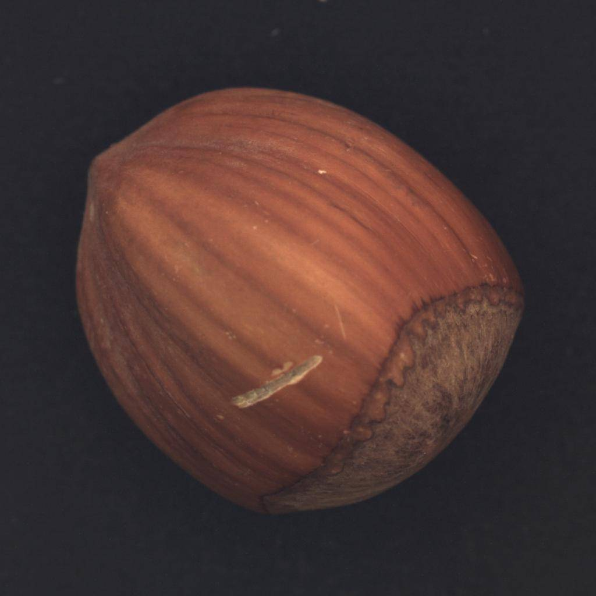</a>
    <a href="/assets/imgs/Papers/DuoAD/hazelnut_ground_truth.jpg">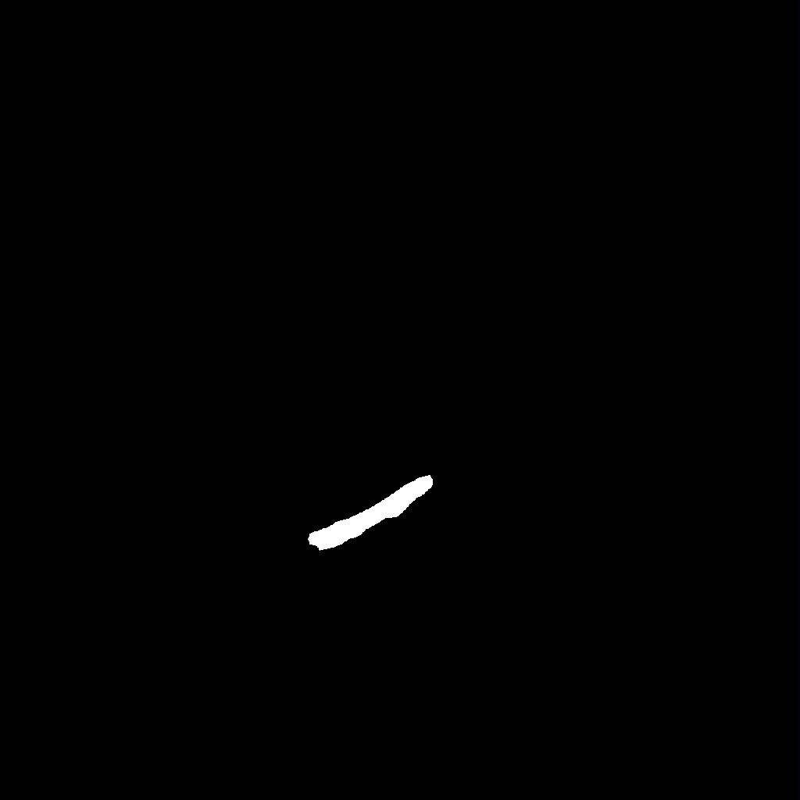</a>
    <a href="/assets/imgs/Papers/DuoAD/hazelnut_cosine.jpg">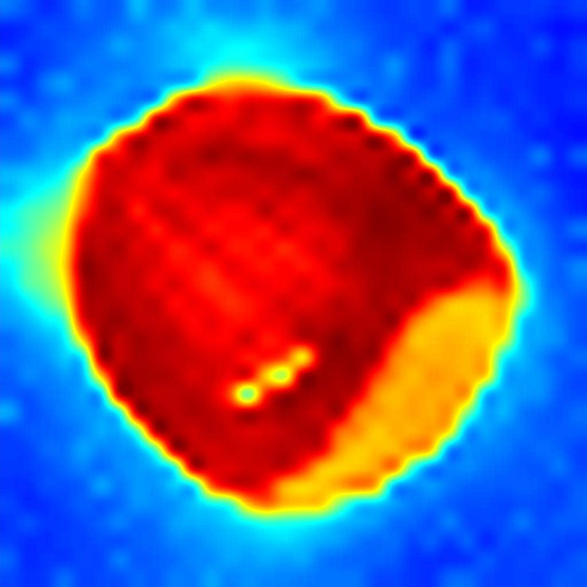</a>
    <figcaption>Hazelnut 範例：input、ground truth、CLS–patch cosine similarity。Cosine similarity 能大致區分前景與背景，但異常區域的響應與正常前景混在一起，不適合用來加權。</figcaption>
</figure>

### 第二個嘗試：Post-Softmax Attention Weights
同一時間，PatchEAD 觀察到 ViT 最後一層的 `[CLS]` attention weights 可以用來切割前後景：前景區域經常獲得較高的 attention response，能透過一個 threshold 切出來，看起來是個不錯的 Saliency 信號。但我進一步發現，分數經過 Softmax 後會變得非常稀疏，少數 patch 拿走絕大部分權重。這種「贏者全拿」的輸出不適合拿來做 Reweighting，這也是為何 PatchEAD 只用了手動 threshold 二值化；何況高 attention 不等於瑕疵位置，只是 ViT empirically 對異常區域的響應較強，這也是本篇 DuoAD 論文的發現之一。

下圖第四欄是 Post-softmax attention weights：雖然異常處有亮點，但響應過度集中，周圍正常區域幾乎被壓到零，無法平滑地調整每個 patch 的貢獻。

<figure class="third">
    
    
    <a href="/assets/imgs/Papers/DuoAD/hazelnut_attention_weight.jpg">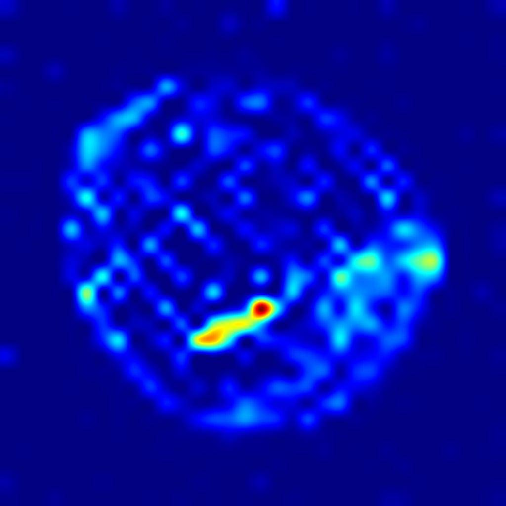</a>
    <figcaption>Hazelnut 範例：input、ground truth、post-softmax attention weights。異常區域確實有較高響應，但 Softmax 後過度稀疏，周圍細節幾乎消失，不適合直接用於連續加權。</figcaption>
</figure>

### 最終選擇：Pre-Softmax Attention Logits
既然 Post-softmax 的問題來自 softmax 的競爭式 normalization，直接使用 softmax 之前的 raw score，也就是 attention logits，就能保留完整的響應範圍。如下面最右欄所示，Pre-softmax attention logits 在異常區域有明顯高響應，同時保留正常區域的連續變化，適合用來平滑地對 patch anomaly scores 做 reweighting。

<figure class="third">
    
    
    <a href="/assets/imgs/Papers/DuoAD/hazelnut_attention_logits.jpg">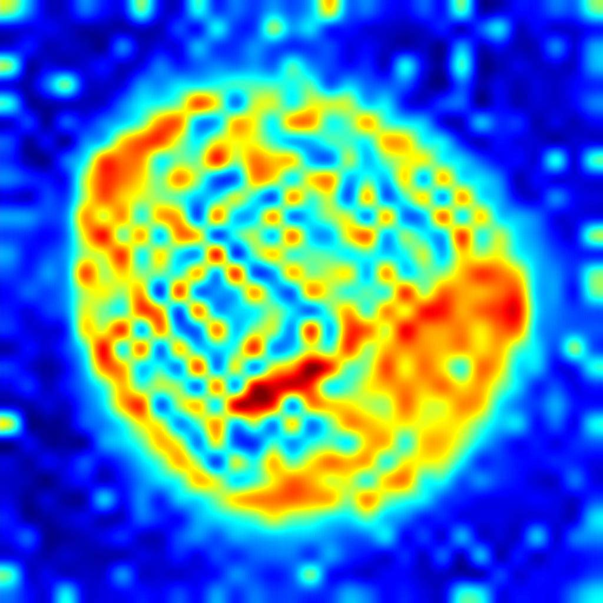</a>
    <figcaption>Hazelnut 範例：input、ground truth、pre-softmax attention logits。Logits 在異常區域保持高響應，且保留正常區域的連續空間資訊，適合作為 dense Saliency weighting 的依據。</figcaption>
</figure>

### 兩個看似衝突的觀察
Cosine similarity 對局部瑕疵穩定，attention logits 對局部結構異常敏感。這兩個信號的行為互補，正好能分別用在不同任務上。

這就是 DuoAD 標題中的 **Dual Characteristics**。論文進一步在 MVTec-AD 上驗證這個現象：異常 patch 傾向呈現「高 attention logits、低 cosine similarity」的分布，背景則在兩種信號中都被抑制。

<figure>
    <a href="/assets/imgs/Papers/DuoAD/dual_distribution.jpg">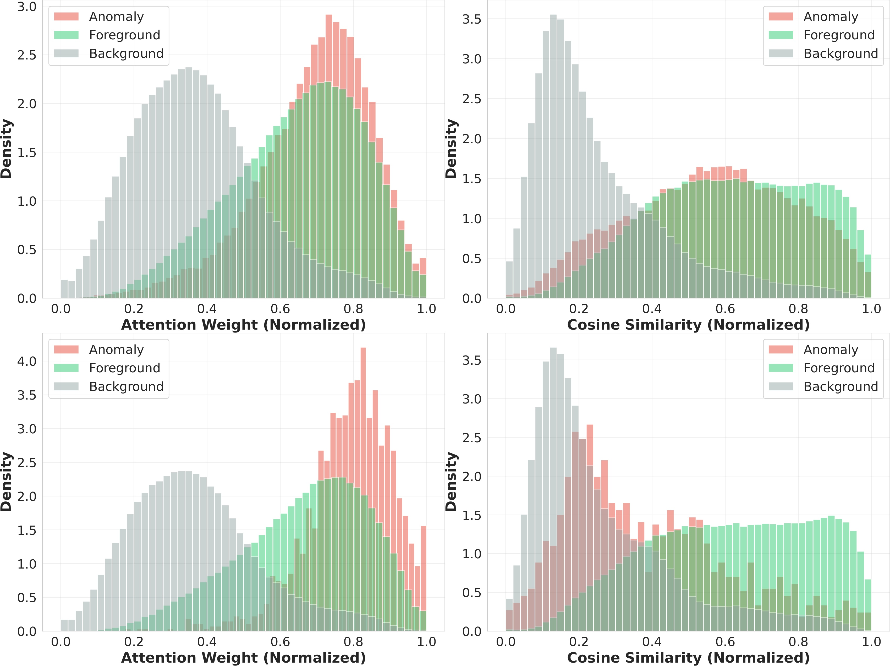</a>
    <figcaption>MVTec-AD（DINOv2 w/ Registers）上 Object categories 的統計分布；上排為所有缺陷尺寸，下排為面積 ≤1% 的細微缺陷。異常 Patch（紅）呈現高 attention logits 但低 cosine similarity，背景（灰）在兩種信號中均被抑制。</figcaption>
</figure>

這個發現後來衍伸成兩條應用路線：

1. 利用 `[CLS]` embedding 對局部瑕疵不敏感的特性，判斷 augmentation 後的資料是否偏離原始分布，藉此決定該 augmentation 能否使用。  
2. 利用 Attention logits 對異常敏感的特性，重新調整 patch anomaly score 的空間權重。

### Why?
至於為何 ViT 會有這樣的表現，我大膽猜測是 loss 設計的關係。概念上來說，ViT 要分類一個物件屬於誰，或是概念上跟哪些 feature 比較近，其 global feature 必須得忽略一些雜訊是吧？舉例來說，分辨車子和人，它需要看到車子板金上的刮痕嗎？分辨人需要看到臉上的痘痘嗎？概念上來說 Global information 的目的是要捕捉 global 訊息，這些 **`瑕疵`** 對他來說都是雜訊，因此在訓練過程中，這些 local feature 會被網路刻意的忽略掉。這也導致 ViT 的 `[CLS]` token 與瑕疵的 patch token 之間有較低的相似度。

至於 Attention 在最後一層反而關注它，我認為原因在這些異常的 patch 提供了較多可以挑戰全局特徵的局部訊息，因此 ViT 在最後一層全域訊息層才重點關注。

整篇研究中，最難定義貢獻的元件其實是 SCA。Attention logits 的用途相對直接：高 Saliency 區域增加權重，低 Saliency 區域降低權重。SCA 面對的問題更微妙，因為「符合資料分布」和「取得最高 benchmark performance」屬於不同目標。

以旋轉為例，某個零件在真實資料中從未旋轉，SCA 因此會拒絕 rotation，因為旋轉後的 feature distribution 明顯偏離觀察到的 target distribution。

但在 Benchmark 上，強制加入 rotation 仍可能提高 feature diversity，最後取得更高 AUROC。只是這類增益必須透過 Label、validation performance 或事後 backtrace 才能驗證，違反了 DuoAD 全自動、無人工介入的設定初衷。SCA 的目的是：

> 在產線初期缺少 Label、validation set 與人工設定時，先給出一個 distribution-preserving 的 safe augmentation policy。

它避免明顯有害的轉換，讓系統可以直接開始運作，不需要人工介入。這對大規模部署與產線 Scale up 是很實際的功能，你不能期望每個產線員工都是 AI 專家，清楚各種奇怪的參數該怎麼調。全自動化才能避免錯誤發生。當然，這裡也牽扯到學術和業界之間的差異：學術上未必覺得這很重要，畢竟就只是一個參數設定，但每多一個參數，就多一分出錯的機率。

## Few-Shot Memory Bank
雖然 Memory bank 已經不是新東西，還是先看一下 patch memory bank 的運作方式。

假設只有一張正常參考影像。ViT 會將影像切成 patch tokens，並輸出每個位置的 feature，此時每個 patch 都可以視為一個 local feature descriptor。這些 Patch features 收集起來就構成 memory bank。檢測時，每個測試 Patch 都到 memory bank 中尋找最接近的正常 feature；距離越大，代表這個 patch 越偏離正常分布。

DuoAD 的 framework 圖（見下節）也描繪了這個流程：從少量正常參考影像提取 multi-layer patch features，建構 memory bank，再與測試影像進行 nearest-neighbor matching。

令 Memory bank 為：

$$
\mathcal{M} \in \mathbb{R}^{K \times D}
$$

其中 $K$ 是儲存的 Feature 數量，$D$ 是 feature dimension。對測試影像第 $i$ 個、已經 L2 normalized 的 patch feature $f_i$，基本 anomaly score 為：

$$
s_i
=
\min_{m \in \mathcal{M}}
\left(1-f_i^\top m\right)
$$

這就是最基本的 Cosine nearest-neighbor matching。

## DuoAD 的完整流程
DuoAD 分成 warmup stage 和 inference stage：

<figure>
    <a href="/assets/imgs/Papers/DuoAD/framework.jpg">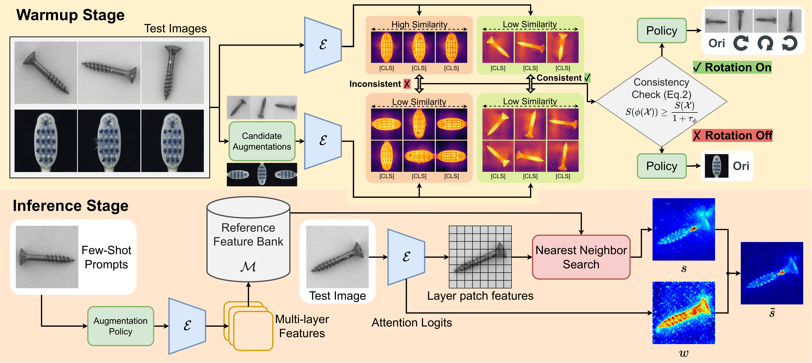</a>
    <figcaption>DuoAD pipeline。Warmup stage 使用未標註 target-domain images 決定 augmentation policy；inference stage 以少量正常 reference 建立 multi-layer memory bank，再使用 attention logits 重新加權 patch anomaly scores。</figcaption>
</figure>

從左到右來看，上下分為兩階段：
1. **上方 Warmup stage**：未標註的 target-domain images（包含正常和瑕疵）經過 Self-Calibrated Augmentation，選出安全的 augmentation policy。
2. **下方 Inference stage**：少量正常 reference 經過選定的 augmentation policy 擴充後，建立 multi-layer feature memory bank；測試影像的 patch features 與 memory bank 做 nearest-neighbor matching，再以 `[CLS]` attention logits 對 patch scores 做重加權，得到 final anomaly map。

核心元件共有三個：

1. Self-Calibrated Augmentation (SCA)
2. Attention-Guided Feature Reweighting (Saliency)
3. Multi-Level Feature Fusion

## 1. Self-Calibrated Augmentation
### 為什麼 Augmentation Policy 很難設定？
Few-shot AD 的 reference 太少，augmentation 幾乎是最直接的 feature expansion 方法。

對方向不敏感的物件，Rotation 和 flip 可以大幅增加 coverage。對方向、文字、接腳位置或結構排列有意義的物件，同一組操作可能產生不合理 Reference。

常見做法包含：

- 所有類別套用相同 Augmentation。
- 人工逐類別設定 Rotation、flip。
- 透過 Validation set 選擇最高分 policy。

第一種方式容易傷害方向敏感類別。第二種方式難以擴展到大量產線。第三種方式需要 Label 或 performance feedback，冷啟動階段通常沒有這些資訊。

### 用 Distribution Consistency 決定 Policy
SCA 使用一組未標註 calibration set：

$$
\mathcal{X}=\{x_1,x_2,\ldots,x_n\}
$$

這些圖片可以來自：

- 產線 Commissioning warmup
- Batched inference
- Online calibration buffer

對每張圖片提取 `[CLS]` embedding：

$$
f(x) \in \mathbb{R}^{d}
$$

接著計算集合內不同來源影像之間的平均 Pairwise cosine similarity：

$$
S(\mathcal{X})
=
\frac{1}{|\mathcal{P}|}
\sum_{(x_i,x_j)\in\mathcal{P}}
\operatorname{sim}\left(f(x_i),f(x_j)\right)
$$

其中：

$$
\mathcal{P}
=
\left\{
(x_i,x_j)
\mid
x_i,x_j\in\mathcal{X},
\operatorname{src}(x_i)\neq\operatorname{src}(x_j)
\right\}
$$

`src` 限制用來避免原圖和自己的 augmented version 互相比較，造成不合理的高相似度。

對候選 Augmentation $\phi$，SCA 再計算轉換後集合的 coherence：

$$
S(\phi(\mathcal{X}))
$$

若轉換後的集合仍維持足夠一致性，就接受該操作：

$$
S(\phi(\mathcal{X}))
\geq
\frac{S(\mathcal{X})}{1+\tau_{\phi}}
$$

其中 $\tau_{\phi}$ 是固定的 Operator-specific tolerance。論文在所有 Backbone 和 dataset 上固定使用：

- Rotation：$\tau_{\phi}=0.017$
- Flip：$\tau_{\phi}=0.003$

這個判斷只會輸出 Accept 或 reject，沒有使用 anomaly label、validation score、anomaly-score feedback 或逐類別人工設定。

### 一個直覺例子
如果某條產線上的螺絲方向差異很大，旋轉後的樣本仍然屬於同一個物件分布，`[CLS]` coherence 幾乎不變，SCA 就會接受 rotation。反之，如果零件具有固定方向或接腳排列，旋轉後的樣本會偏離原本的 Semantic manifold，coherence 明顯下降，SCA 就會拒絕 rotation。SCA 關心的始終是轉換後的資料能否維持目前觀察到的 distribution。

### Safe Policy 和 Best Policy 的差異

SCA 的 policy 選擇依據是 distribution consistency。只要某個 Transformation 明顯破壞物件方向、結構或 pose 分布，它就會被拒絕。這個準則可以在沒有 Label 的條件下執行，也符合產線冷啟動需求。

但是 Benchmark performance 還受到 feature diversity 影響。某些 Distribution-shifting augmentation 雖然不符合原始資料分布，仍可能擴大 memory bank coverage，降低測試樣本的 matching distance。

VisA 的 `Macaroni1`、`Zipper` 類別就呈現這種情況。AugAll 有時能靠更廣的 transformed references 得到額外增益，SCA 則傾向保守地維持原始 distribution。

**SCA** 負責在沒有 label 的情況下自動產生安全且可部署的 policy；事後透過 validation 或 backtrace 尋找最高分的 policy 不是他的守備範圍。前者解決產線初期的可部署性，後者處理後續最佳化。

### 為什麼髒資料也能運作？
SCA 的 warmup set 可以包含異常樣本。其穩定性來自兩層機制。

第一層是 `[CLS]` embedding 對局部缺陷的 Semantic Stability。預訓練 ViT 通常以主要前景、物件類型和整體結構形成 global representation，小範圍瑕疵對集合 coherence 的影響有限。

第二層是 Relative coherence change。瑕疵會同時存在於 $\mathcal{X}$ 和 $\phi(\mathcal{X})$，其影響在比值中部分抵消。錯誤 Transformation 會改變整體 semantic manifold，造成更明顯的 coherence drop。

Supplementary 將 MVTec-AD 的 anomaly contamination 從 `0%` 提高到 `100%`。Object categories 的 policy 維持高度一致；Texture categories 在高污染率下出現部分 policy transition，但 Texture 本身通常缺乏固定方向，這些變化對檢測結果影響有限。

<figure>
    <a href="/assets/imgs/Papers/DuoAD/sca_contamination.jpg">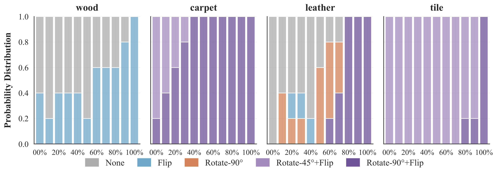</a>
    <figcaption>SCA 在不同 anomaly contamination rate 下的 policy distribution。主要變化集中在 Directionless Texture categories，Object categories 維持穩定。</figcaption>
</figure>

### Warmup 需要多少樣本？
論文以 60 張樣本得到的 Policy 作為 reference，再測量不同 sample count 的 policy inconsistency。

結果顯示：

- 超過 10 張後，Inconsistency 明顯下降。
- 20 到 30 張後逐漸穩定。
- 主要實驗使用 30 張 Warmup samples。
- 資料不足時仍可使用更少樣本，代價是較高 Policy variance。

| Sample Count | MVTec DINOv3 I-AUC | MVTec DINOv3 P-PRO | VisA DINOv3 I-AUC | VisA DINOv3 P-PRO |
|---:|---:|---:|---:|---:|
| 2 | 97.7 | 94.7 | 92.1 | 92.9 |
| 4 | 97.7 | 94.7 | 93.2 | 93.1 |
| 10 | 97.7 | 94.7 | 92.2 | 92.9 |
| 20 | 97.7 | 94.7 | 93.2 | 93.2 |
| 30 | 97.7 | 94.7 | 93.2 | 93.2 |
| 40 | 97.7 | 94.7 | 93.2 | 93.2 |

VisA 的 PCB1 對小樣本較敏感，原因是資料包含兩個主要 orientation。Warmup set 太小時，可能只抽到其中一個方向，導致 rotation policy 判斷不穩定。

<figure>
    <a href="/assets/imgs/Papers/DuoAD/sample_count.jpg">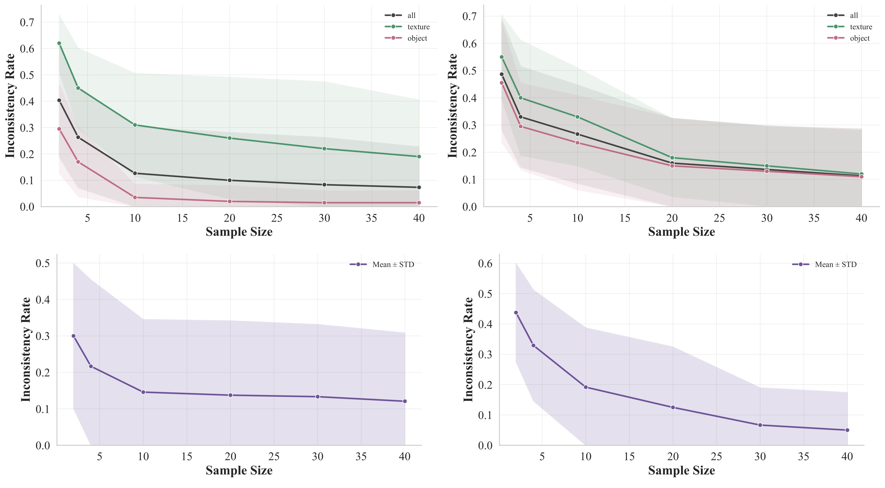</a>
    <figcaption>Warmup sample count 對 policy inconsistency 的影響。左至右、上至下分別為 DINOv3 / MetaCLIP2 在 MVTec-AD，以及 DINOv3 / MetaCLIP2 在 VisA 的結果。Object categories 的不一致率低於 Texture categories；超過 10 張後顯著下降，20–30 張後趨於穩定。</figcaption>
</figure>

<figure>
    <a href="/assets/imgs/Papers/DuoAD/threshold_boundary.jpg">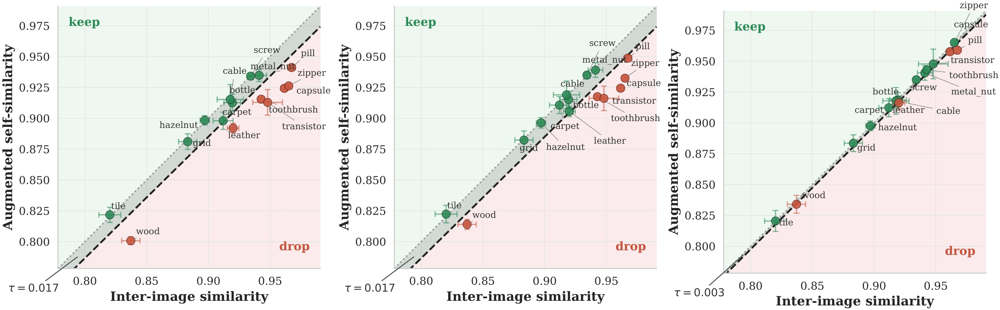</a>
    <figcaption>SCA 在 MVTec-AD 上的 decision boundary（DINOv3）。由左至右為 45° 旋轉、90° 旋轉與水平翻轉；縱軸為增強後的類內一致性 $S(\phi(\mathcal{X}))$，橫軸為原始一致性 $S(\mathcal{X})$，虛線為接受門檻 $S(\phi(\mathcal{X})) = S(\mathcal{X})/(1+\tau_\phi)$。綠點為接受的類別，紅點為拒絕的類別。</figcaption>
</figure>

## 2. Attention-Guided Feature Reweighting
### Patch Matching 缺少 Spatial Importance
標準 Memory bank 只看 patch feature distance：

$$
s_i
=
\min_{m\in\mathcal{M}}
\left(1-f_i^\top m\right)
$$

這個分數沒有區分背景、正常前景和結構關鍵區域。背景紋理改變、光線或邊界噪聲都可能產生高 Matching cost。

DuoAD 從 ViT 最後一層取出 `[CLS]` 到所有 local patches 的 pre-softmax attention logits：

$$
L \in \mathbb{R}^{H\times N}
$$

其中 $H$ 是 Attention heads 數量，$N$ 是 patch 數量。

### 為什麼用 Pre-Softmax Logits？
Softmax 會讓所有 patch attention 互相競爭：

$$
\operatorname{softmax}(L_i)
=
\frac{e^{L_i}}{\sum_j e^{L_j}}
$$

結果通常變得稀疏，少數 Patch 取得大部分權重，其餘位置接近零，拿來做 Dense reweighting 時容易丟失連續細節。

Pre-softmax logits 保留完整 response range，你可以把它想像是 ViT 對每個 patch 打的原始分數。

### Head-Wise Normalization
拿到 Raw score 後，再對每個 attention head 做 spatial min-max normalization，再跨 heads 平均：

$$
\bar{a}_i
=
\frac{1}{H}
\sum_{h=1}^{H}
\frac{
L_{h,i}-\min_j L_{h,j}
}{
\max_j L_{h,j}-\min_j L_{h,j}+\epsilon
}
$$

接著做 Mean-centering：

$$
w_i
=
\bar{a}_i-\mu_{\bar{a}}+1
$$

其中：

$$
\mu_{\bar{a}}
=
\frac{1}{N}
\sum_{i=1}^{N}\bar{a}_i
$$

這樣每張圖的平均權重會落在 `1.0`，權重範圍維持在 $[0,2)$。

Mean-centering 後，$w_i$ 以 `1.0` 為錨點：低於 1 的權重抑制低 Saliency 區域與背景噪聲，接近 1 的權重維持一般前景 patch，大於 1 的權重則放大高 Saliency 結構與異常區域。

最後將 Attention weight 乘上原始 patch anomaly score：

$$
\tilde{s}_i
=
w_i\cdot s_i
$$

### 為什麼不能只用 Attention Map 當作 Anomaly Map？
Attention logits 會關注結構重要的位置，其中有時也包含正常物件邊界、零件中心或高對比區域。單獨把 Attention 當作 anomaly map 會產生大量 false positive。

Nearest-neighbor distance 和 attention weight 一起用才能互補：高 matching cost 加上高 attention 會產生強異常響應；高 matching cost 但低 attention 的背景噪聲會被抑制；低 matching cost 但高 attention 的則是正常但重要的物件結構；高 matching cost 但中 attention 則是看似正常，實質上與 memory bank 不同的異常區域。

### Reweighting Signal Ablation

<table>
    <thead>
        <tr>
            <th rowspan="2">Normalization</th>
            <th rowspan="2">Signal</th>
            <th colspan="2">MVTec</th>
            <th colspan="2">VisA</th>
        </tr>
        <tr>
            <th>I-AUC</th>
            <th>P-PRO</th>
            <th>I-AUC</th>
            <th>P-PRO</th>
        </tr>
    </thead>
    <tbody>
        <tr><td>Max-Normed</td><td>Pre-Softmax</td><td>97.5</td><td>93.0</td><td>92.7</td><td>92.9</td></tr>
        <tr><td>Max-Normed</td><td>Post-Softmax</td><td>92.3</td><td>86.2</td><td>80.3</td><td>85.6</td></tr>
        <tr><td>Max-Normed</td><td>Cosine Distance</td><td>96.6</td><td>94.2</td><td>92.4</td><td>92.0</td></tr>
        <tr><td>Mean-Centered</td><td>Pre-Softmax</td><td><strong>97.7</strong></td><td>94.7</td><td><strong>93.2</strong></td><td><strong>93.2</strong></td></tr>
        <tr><td>Mean-Centered</td><td>Post-Softmax</td><td>97.4</td><td><strong>95.1</strong></td><td>92.7</td><td>92.6</td></tr>
    </tbody>
</table>

Mean-centered pre-softmax 在兩個 dataset 的 image-level AUROC 最穩定，整體 trade-off 也最好。Post-softmax 在 MVTec P-PRO 略高，跨 dataset 表現較不一致。

## 3. Multi-Level Feature Fusion
ViT 不同 layer 會保留不同層次的資訊：

- 淺層 Features 保留較多紋理材質。
- 中層 Features 通常保留較多局部紋理與幾何結構。
- 後層 Features 擁有較強語意和物件層次資訊。
- 最後一層有時過度抽象，細小缺陷的局部差異會被壓縮。

DuoAD 從 12-layer backbone 的：

$$
\mathcal{L}=\{8,10,12\}
$$

建立獨立 Memory banks，分別計算 anomaly scores 後取平均：

$$
s_i
=
\frac{1}{|\mathcal{L}|}
\sum_{l\in\mathcal{L}}
\min_{m\in\mathcal{M}_l}
\left(
1-{f_i^{(l)}}^\top m^{(l)}
\right)
$$

Layer ablation 顯示，layer 8 之後的組合相對穩定。`{8,10,12}` 在效能和 feature bank 成本之間提供穩定平衡。

<table>
    <thead>
        <tr>
            <th rowspan="2">Layer</th>
            <th colspan="2">MVTec</th>
            <th colspan="2">VisA</th>
        </tr>
        <tr>
            <th>DINOv2 I-AUC</th>
            <th>DINOv3 I-AUC</th>
            <th>DINOv2 I-AUC</th>
            <th>DINOv3 I-AUC</th>
        </tr>
    </thead>
    <tbody>
        <tr><td>7</td><td>94.8</td><td>96.4</td><td>88.6</td><td>91.3</td></tr>
        <tr><td>8</td><td>96.4</td><td>97.1</td><td>90.4</td><td>92.6</td></tr>
        <tr><td>9</td><td>96.7</td><td>97.6</td><td>91.5</td><td>93.4</td></tr>
        <tr><td>10</td><td>97.1</td><td>97.7</td><td>92.9</td><td>93.6</td></tr>
        <tr><td>11</td><td>96.8</td><td>97.0</td><td>92.5</td><td>92.5</td></tr>
        <tr><td>12</td><td>96.0</td><td>95.1</td><td>88.2</td><td>85.4</td></tr>
        <tr><td>8–12</td><td>97.2</td><td>97.7</td><td>92.8</td><td><strong>93.4</strong></td></tr>
        <tr><td>8, 10, 12</td><td><strong>97.3</strong></td><td><strong>97.7</strong></td><td><strong>92.7</strong></td><td>93.2</td></tr>
    </tbody>
</table>

這也打翻了先前許多 Paper 針對 DINOv2 和 DINOv3 在 AD 上的比較。

只使用單層或缺少 Multi-level fusion 時，DINOv3 表現低於 DINOv2。但加入多層 Features、attention reweighting 和 augmentation 後，DINOv3 的 global semantics 與 multi-level representations 才能充分發揮，最終取得更高整體結果。

## Performance
為了避免 SCA 的 warmup setting 產生 unfare 對比問題，論文中將 SCA 和 AugAll（無腦打開所有 augmentation）分開回報。而 SCA 則以 transductive setting 檢視。

## 實驗設定
論文使用三個工業異常檢測資料集：

- `MVTec-AD`：15 個類別，包含 Object 和 Texture。
- `VisA`：12 個類別，具有較複雜的物件、食品與 PCB 結構。
- `Real-IAD`：30 個類別、151,050 張影像，包含多視角資料。

主要 Backbones：

- DINOv2 ViT-b/14 with Registers，輸入 `448 × 448`
- DINOv3 ViT-b/16，輸入 `512 × 512`
- MetaCLIP2 ViT-b/16，輸入 `384 × 384`，用於跨架構 ablation

主要 Metrics：

- `I-AUC`：image-level AUROC，衡量整張圖的異常分類能力。
- `P-PRO`：pixel-level AUPRO，衡量不同瑕疵區域的定位品質。
- Supplementary 另提供 `I-AUPR`、`I-F1max`、`P-AUC`、`P-F1max`。

Image-level anomaly score 取 anomaly map 中最高 `1%` 像素的平均值。Real-IAD 採多視角 memory bank，每個 view 分別建立 reference bank，再聚合各 view predictions。

所有 DuoAD 結果使用相同五組 random seeds，並回報 mean ± standard deviation。

## MVTec-AD 與 VisA 結果
DuoAD 在 1-Shot & 4-Shot 於 SCA & AugAll setting 皆能取得 SOTA 的成果。
<figure>
    <a href="/assets/imgs/Papers/DuoAD/MVTec_res.jpg">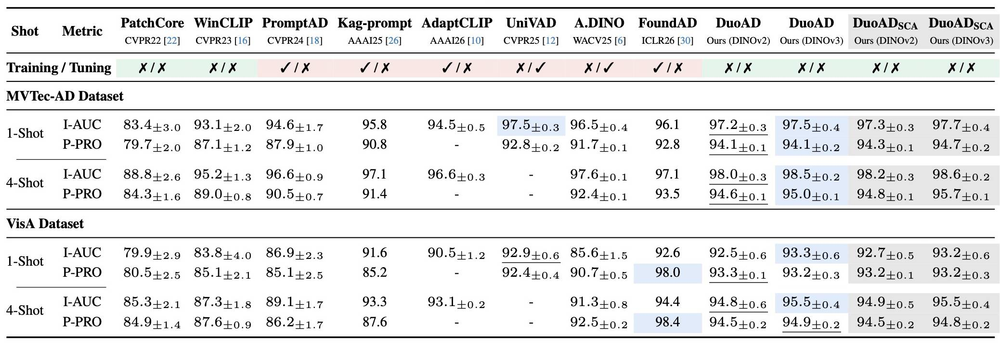</a>
</figure>

Real-IAD 上 AugAll 高於 SCA 的現象正好反映 safe policy 和 performance-optimal policy 的差異。

<figure>
    <a href="/assets/imgs/Papers/DuoAD/Real-IAD_res.jpg">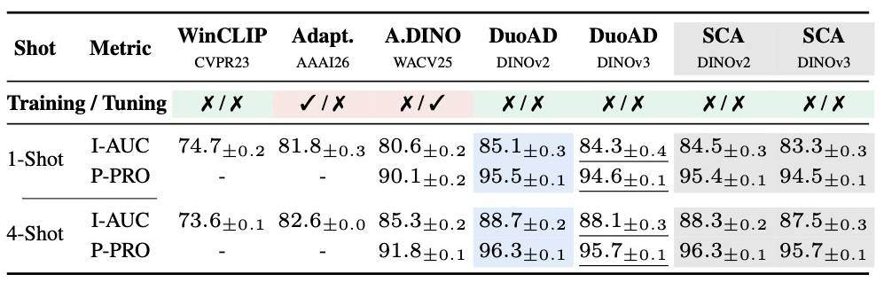</a>
    <figcaption>Warmup sample count 對 policy inconsistency 的影響。左至右、上至下分別為 DINOv3 / MetaCLIP2 在 MVTec-AD，以及 DINOv3 / MetaCLIP2 在 VisA 的結果。Object categories 的不一致率低於 Texture categories；超過 10 張後顯著下降，20–30 張後趨於穩定。</figcaption>
</figure>

Real-IAD 的 C2–C5 view 具有非 top-down 的斜視角。Image rotation 等 augmentation 會破壞 consistency，SCA 會傾向拒絕；但是強制加入 rotation 仍可能增加 feature diversity，讓 AugAll 在部分設定得到更高結果。

## Augmentation Strategy Ablation
SCA 在 MVTec-AD 上比 AugAll 更高，在 VisA 上維持接近表現。

| Backbone | Dataset | NoAug | AugAll | SCA |
|---|---|---:|---:|---:|
| DINOv3 | MVTec-AD | 95.2 | 97.5 | **97.7** |
| DINOv3 | VisA | 90.9 | **93.3** | 93.2 |
| DINOv2 | MVTec-AD | 95.6 | 97.2 | **97.3** |
| DINOv2 | VisA | 91.7 | 92.5 | **92.7** |

幾個代表性類別：

- `Screw`：rotation 對 coverage 很重要，NoAug 大幅落後。
- `Capsule`、`Pill`：方向與結構有意義，SCA 會拒絕部分轉換。
- `Macaroni1`、`Zipper`：AugAll 可能受惠於更大的 feature diversity。
- `PCB1`：多個主要 orientation 使 sample count 對 policy 判斷更敏感。

## Qualitative Results
<figure class="half">
    <a href="/assets/imgs/Papers/DuoAD/qualitative_mvtec.jpg">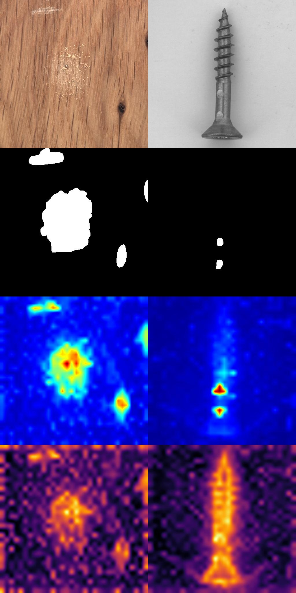</a>
    <a href="/assets/imgs/Papers/DuoAD/qualitative_visa.jpg">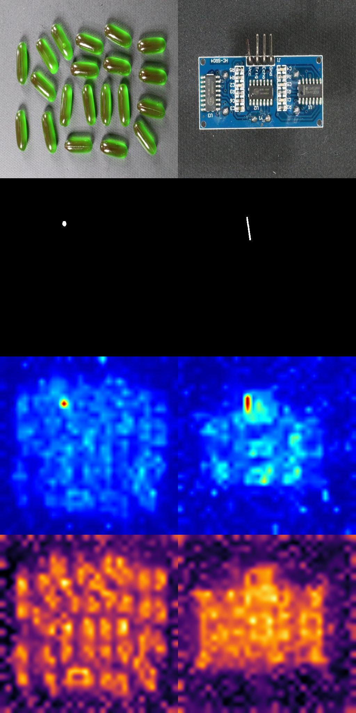</a>
    <figcaption>MVTec-AD（左）與 VisA（右）的定性結果。由上到下分別為 Input、ground truth、DuoAD anomaly map 與 attention logits。Attention logits 將權重集中在結構異常區域，再由 memory-bank distance 決定最終異常強度。</figcaption>
</figure>

## 和其他 Few-Shot AD 方法差在哪裡？
Few-shot AD 方法大致可以分成幾類。

### Memory-Bank Matching
PatchCore、AnomalyDINO 直接儲存正常 patch features，再執行 nearest-neighbor search。架構簡單且可解釋，但 Augmentation、layer selection 和 preprocessing 經常需要人工設定。

### VLM Prompting / Adapter
WinCLIP、PromptAD、AdaptCLIP 使用文字 prompt、learnable tokens 或 adapter 建立 normal / abnormal semantics。語意能力較強，但對細微工業瑕疵有時缺少足夠的局部辨識力，部分方法也需要額外訓練。

### Multi-Model Fusion
UniVAD、LogSAD 結合多個 foundation models、prompts 或 segmentation components。泛化能力較強，但計算量、架構複雜度和 Hyperparameters 也隨之增加。且依據我的觀察，這類號稱 general 的方法很多都是縫合怪，有著滿滿的 config 和很多針對 dataset 不同 class 的判斷式，無法針對一個沒看過的資料快速部署。

### Manifold / Synthetic Anomaly Training
FoundAD 等方法學習正常 manifold 或使用 synthetic anomaly training，能處理細粒度的結構歧義，但訓練成本和 dataset dependency 隨之增加。

DuoAD 保留單一 ViT backbone，從同一個 `[CLS]` token 同時取得 global semantic consistency 與 local structural Saliency，因此能在 training-free memory-bank framework 中加入 global context，並移除人工設定需求。

## Dual Characteristics 的實驗證據
論文將 Patch 分成：

- Anomalous foreground
- Normal foreground
- Background

再分析 `[CLS]` 與 patch tokens 的 attention logits 和 cosine similarity。

主要結果如下：

1. Anomalous patches 的 attention logits 高於一般 foreground。
2. Background 在 attention 和 cosine similarity 上都受到抑制。
3. Defect area 小於等於 `1%` 時，high-attention pattern 更清楚。
4. 瑕疵範圍變大後，Global `[CLS]` context 會受到更多污染，分布差異變弱。
5. DINOv2 和 DINOv3 都呈現 high-attention / distinct-similarity 的異常群集。
6. MetaCLIP2 的分離較弱，符合 image-text alignment 偏向高階語意的特性。

<figure>
    <a href="/assets/imgs/Papers/DuoAD/joint_distribution.jpg">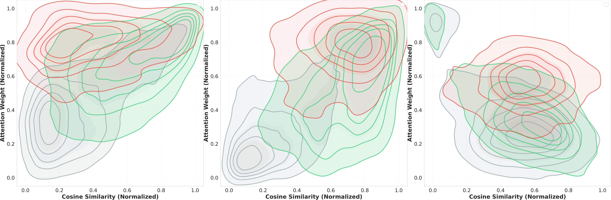</a>
    <figcaption>小瑕疵條件下的 Joint distribution（KDE）。左至右分別為 DINOv2、DINOv3 與 MetaCLIP2；異常 patch（紅）在 DINOv2 / DINOv3 中形成明顯的 high-attention / low-cosine cluster，MetaCLIP2 的空間分離則較弱。</figcaption>
</figure>

這項分析也說明兩個訊號適合不同用途。

`[CLS]` embedding 的穩定性適合做 set-level consistency；pre-softmax attention logits 的局部變化適合做 patch-level weighting。將用途交換，效果會下降。

## 限制
DuoAD 仍有幾個明顯限制。

1. 核心元件依賴 ViT 的 `[CLS]` 和 patch attention interaction。CNN 缺少相同結構，無法直接套用這套方法。
2. SCA 需要一小批未標註 target-domain samples。它可以在 Warmup、batched inference 或 online calibration 中執行。
3. SCA 會優先選擇 distribution-preserving augmentations。某些偏離原始分布的轉換仍可能增加 Feature diversity，取得更高 benchmark performance。這類最佳化需要 Label、validation 或事後 backtrace。
4. SCA 目前主要驗證 geometric transformations，例如 rotation 和 flip。Brightness、contrast、color jitter 等 photometric candidates 可以套用相同原理，但目前該 augmentation 對於學術資料集幫助有限。

## 結論
DuoAD 的核心概念可以濃縮成一句話：

> While `[CLS]` embedding ignore anomaly, `[CLS]-Patch` attention highlights abnormal.

DuoAD 將前者用於 Self-Calibrated Augmentation，從含有瑕疵的髒資料中選擇 distribution-preserving 的 safe policy；後者用於 Attention-Guided Feature Reweighting，連續調整 patch anomaly scores。

Multi-Level Feature Fusion 再補上不同 ViT layers 的局部與語意資訊，使 DINOv2、DINOv3 和 MetaCLIP2 都能使用同一套 framework。達成學術資料 Training-Free 的 SOTA。並且相較於其他榜單上的方法，DuoAD 不僅不需要針對不同 dataset or class 設定 config 或是參數，還能夠以單一 ViT-Base 模型達成 SOTA。

DuoAD 最終想解決的問題很直接：

> 只有少數 normal 資料時，只額外使用未標註（可含異常）的產線資料，運用 Vision Transformer 的雙性質特性，在不需人工調參的情況下，仍達到學術 SOTA。  

以上是 DuoAD "學術上" 所解決的問題，但實務上距離工廠落地還有一段路。工廠的資料是超高解析度，MVTec-AD 的 1024×1024 都只能算是低解析度。如何讓這套演算法落地在 Consumer-grade GPU 和 embedded 系統又是另一個問題了；這部分因為學術界缺少對應的 setup，我就沒有寫進論文裡。有興趣的話可以洽詢 Inventec AI center 了解我們的方案 XD  

順帶一提，目前開源的 repo 是 AGPL 3 license，商用必須維持開源精神，如有商用且不開源的需求請洽 Inventec AI center。

## Reference
* [DuoAD Paper](https://arxiv.org/abs/2607.23924)
* [DuoAD Code](https://github.com/inventec-ai-center/DuoAD)
